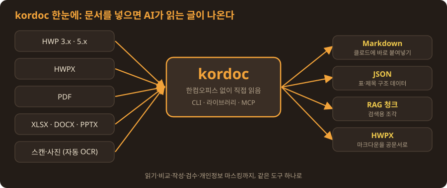
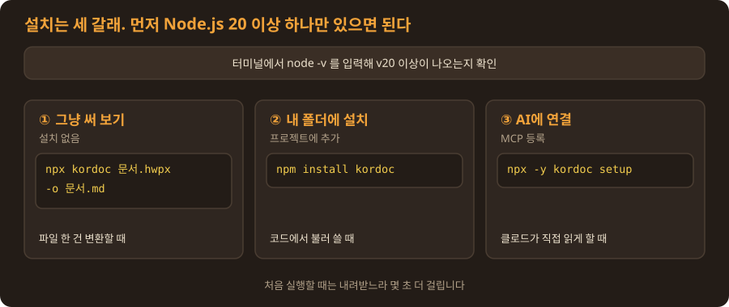
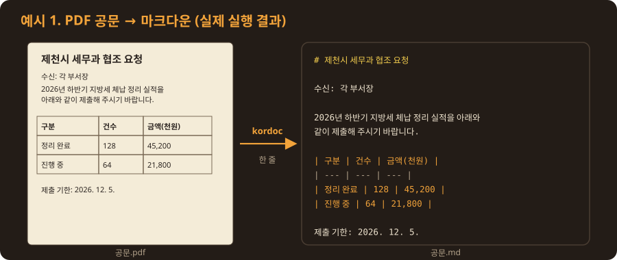
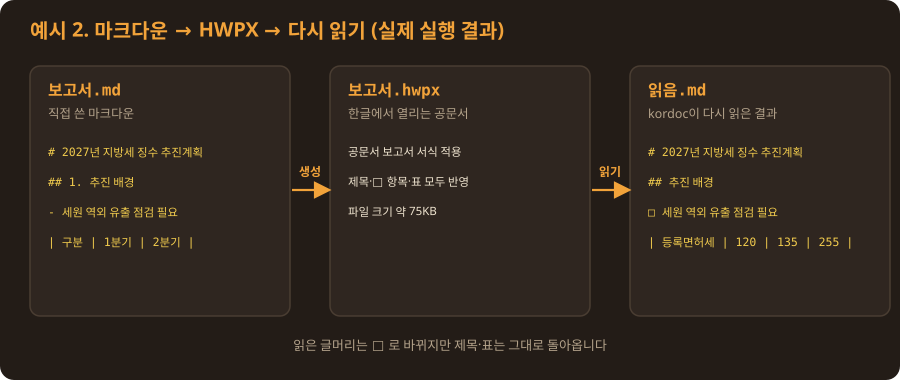
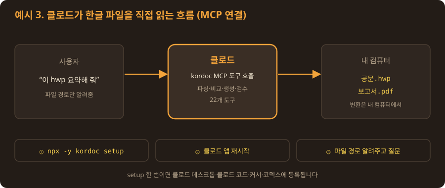
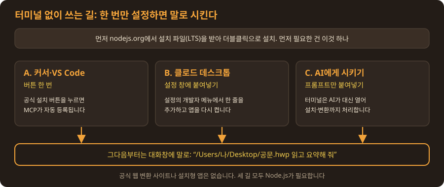
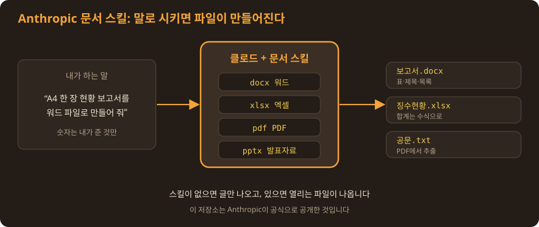
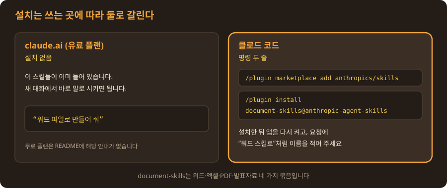
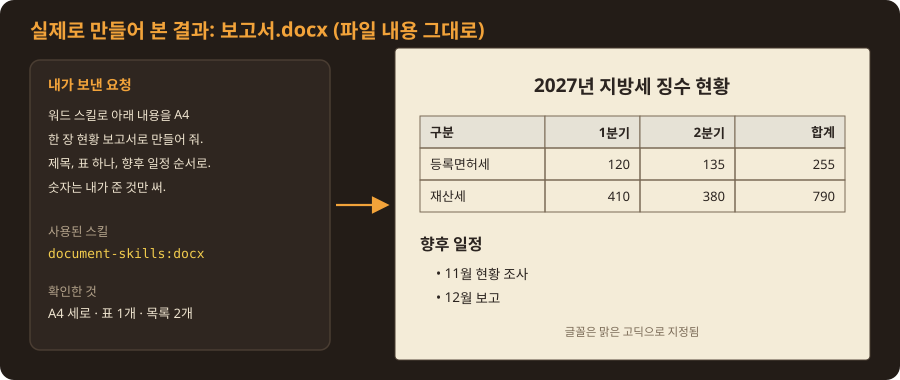
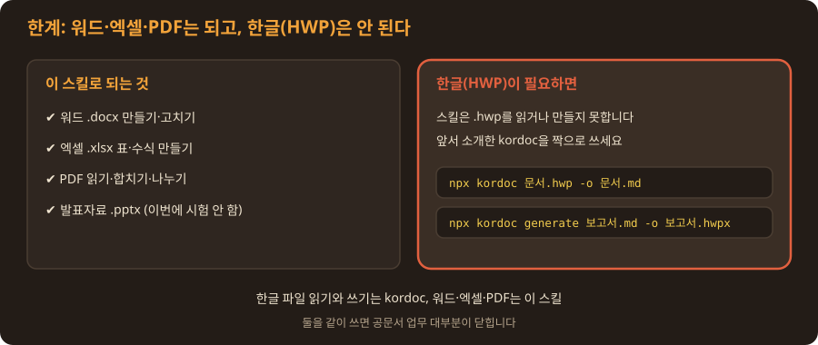

## 워드·PDF를 클로드가 읽는 글로 바꾸는 5단계 | 2026-09-20 | AI·문서변환·MarkItDown
slug: claude-and-markitdown
repo: microsoft/markitdown
minutes: 14
steps: 5
sections: 8
excerpt: 공문 PDF를 클로드 창에 넣으면 깨지거나 중간에 잘립니다. 마이크로소프트 MarkItDown으로 그 파일을 마크다운으로 바꾼 다음, 클로드에 넘기는 다섯 단계입니다.

클로드 창에 공문 PDF를 그대로 올리면 글자가 빠지거나, 표가 한 줄로 뭉개지거나, 용량 제한에 걸려 중간부터 잘리곤 합니다. 이 자료는 마이크로소프트가 공개한 MarkItDown으로 워드·엑셀·PDF를 마크다운 파일로 바꾼 뒤, 그 파일을 클로드에 넘기는 다섯 단계를 담았습니다. 준비물은 파이썬이 돌아가는 컴퓨터와 클로드(또는 커서) 화면 하나입니다.

복사해서 바로 시작하는 프롬프트. 샘플 HTML 변환부터 결과 파일 확인까지 AI에게 맡기기.

터미널을 쓸 수 있는 AI(클로드 코드·커서 등)의 첫 메시지로 붙여넣으세요. 꺾쇠로 표시된 '내 파일' 한 곳만 내 경로로 바꾸면 됩니다. 웹 클로드만 쓰신다면 이 토글은 건너뛰고 STEP 1부터 직접 따라 하세요.

```prompt
역할: 이 컴퓨터에 MarkItDown을 설치하고, 지정한 문서를 마크다운으로 변환하는 담당
맥락: 이 컴퓨터에는 MarkItDown이 아직 없을 수 있고, 저는 개발 경험이 적은 편이라 설치가 됐는지 스스로 판단하기 어렵습니다. 한글(HWP) 파일은 이 도구가 직접 열지 못합니다.
입력: 내 파일 = <변환할 파일의 전체 경로, 예: /Users/나/Desktop/공문.pdf> (운영체제·셸·파이썬 경로는 저에게 묻지 말고 직접 확인하세요)
작업: ① 제 환경을 직접 확인하세요. Python 버전을 알아보고 3.10 미만이면 설치 방법을 초보자 눈높이로 안내한 뒤 여기서 멈추세요. ② 작업 폴더가 있는지 확인하고 없으면 `mkdir -p ~/markitdown-work` 로 만드세요. ③ 그 폴더 안에 가상환경을 만들고 `pip install 'markitdown[all]'` 로 설치하세요. ④ 내 파일이 .hwp 또는 .hwpx 이면 변환하지 말고, 한글에서 PDF로 다시 저장하라고 안내하세요. 그 외 형식이면 `markitdown "<내 파일>" -o ~/markitdown-work/output.md` 로 변환하세요. ⑤ 결과 파일의 앞 40줄과 글자 수를 보여 주고, 이 파일을 클로드 대화에 어떻게 붙이는지 안내하세요.
제약: sudo·전역 설치·시스템 파이썬을 바꾸는 명령은 먼저 물어보세요. API 키나 비밀번호를 화면에 출력하지 마세요. 이미 있는 파일을 덮어쓰지 마세요. Azure Document Intelligence 같은 유료 클라우드 변환은 켜지 마세요.
출력: 실행한 명령, 확인된 Python 버전, MarkItDown 버전, 결과 파일 경로와 글자 수, 남은 오류
검증: `python -c "from importlib.metadata import version; print(version('markitdown'))"` 가 버전 문자열을 출력해야 하고, 변환을 했다면 `~/markitdown-work/output.md` 크기가 0보다 커야 합니다. 하나라도 실패하면 완료로 보고하지 말고 실패한 명령과 원인, 다음 조치를 알려주세요.
```

## Quick Start

- 공식 저장소: [microsoft/markitdown](https://github.com/microsoft/markitdown)
- 설치 패키지: [PyPI markitdown](https://pypi.org/project/markitdown/)
- 한 줄 정의: MarkItDown은 워드·엑셀·PDF 같은 파일을, 클로드가 잘 읽는 마크다운 글자로 바꿔 주는 명령줄 도구입니다. 클로드가 한글 프로그램을 대신 눌러 주는 것은 아닙니다.
- 인기·만든 곳: 2026년 9월 20일 확인 기준 GitHub 스타 185,737개, 이번 주 트렌드에서 2,767개가 늘었습니다. 만든 곳은 마이크로소프트입니다.
- 라이선스: MIT. 개인 일과 기관 업무에 쓰는 것은 허용됩니다.
- 필요한 환경: Python 3.10 이상. 맥·윈도우·리눅스 모두 됩니다. 클로드 계정은 변환 자체가 아니라, 변환된 글을 읽을 때 필요합니다.
- 비용: MarkItDown 설치와 로컬 변환은 무료입니다. 클로드 요금은 따로 나갑니다. README에 있는 Azure 변환 옵션은 이 자료에서 쓰지 않습니다. 그쪽은 클라우드 과금이 붙습니다.

파이썬이 이미 있고 터미널만 열 수 있다면, 아래 네 줄이면 설치까지 끝입니다.

터미널에서 실행:

```bash
mkdir -p ~/markitdown-work
cd ~/markitdown-work
python3 -m venv .venv
source .venv/bin/activate
pip install 'markitdown[all]'
```

윈도우 명령 프롬프트라면 `python3` 대신 `py -3` 를 쓰고, 가상환경은 `source .venv/bin/activate` 대신 `.venv\Scripts\activate` 입니다.

> 검증: 2026-09-20 기준 (PyPI markitdown 0.1.7, Python >=3.10)

설치가 끝나면 아래 한 줄이 버전을 보여 줘야 합니다.

확인:

```bash
python -c "from importlib.metadata import version; print(version('markitdown'))"
```

`0.1.7` 처럼 숫자가 나오면 성공입니다. `No module named markitdown` 이 뜨면 가상환경을 켜지 않은 상태일 가능성이 큽니다. STEP 2로 가세요.

## STEP 1. 파이썬이 있는지 보기: 2분

이 단계에서는 이 컴퓨터가 MarkItDown을 설치할 수 있는 상태인지 확인합니다.

> 용어: 파이썬은 MarkItDown을 실행하는 바닥 프로그램입니다. 워드가 있어야 한글 문서를 열 수 있듯이, 여기선 파이썬이 있어야 변환 명령을 돌릴 수 있습니다.

터미널(맥은 터미널, 윈도우는 명령 프롬프트 또는 PowerShell)을 열고 한 줄을 입력합니다.

터미널에서 실행:

```bash
python3 --version
```

윈도우에서 `python3` 를 못 찾으면 `py -3 --version` 을 시도하세요.

`Python 3.10` 이상이 나오면 다음 단계로 가면 됩니다. 이 글을 쓰는 컴퓨터에서는 `Python 3.14.6` 이 확인됐습니다.

- `command not found` 또는 `파이썬을 찾을 수 없습니다` 가 나오면 [python.org/downloads](https://www.python.org/downloads/) 에서 설치한 뒤, 설치 화면의 "Add python.exe to PATH" 칸을 체크하세요.
- `Python 3.9` 이하가 나오면 버전이 낮습니다. 3.10 이상을 추가로 설치하세요. 이미 있는 3.9를 지울 필요는 없습니다.

## STEP 2. 가상환경에 설치하기: 3분

이 단계에서는 시스템 파이썬을 건드리지 않고, 이 작업 전용 칸에 MarkItDown만 넣습니다.

> 용어: 가상환경은 이 폴더 안에서만 쓰는 파이썬 상자입니다. 여기 설치한 것은 다른 프로그램을 건드리지 않습니다. 상자를 지으면 설치도 함께 사라집니다.

순서는 이렇습니다.

1. 작업 폴더를 만듭니다. 위치는 집 디렉터리 아래 `markitdown-work` 로 통일합니다.
2. 그 안에서 가상환경을 켭니다.
3. `pip install 'markitdown[all]'` 로 설치합니다. 따옴표와 `[all]` 을 빼면 PDF·워드 변환에 필요한 조각이 빠집니다.

터미널에서 실행:

```bash
mkdir -p ~/markitdown-work
cd ~/markitdown-work
python3 -m venv .venv
source .venv/bin/activate
pip install 'markitdown[all]'
```

프롬프트 앞에 `(.venv)` 가 보이면 상자가 켜진 것입니다. 그 상태에서 버전 확인을 다시 합니다.

확인:

```bash
python -c "from importlib.metadata import version; print(version('markitdown'))"
```

숫자가 나오면 설치는 끝난 것입니다.

- ❌ 이렇게 말고: `pip install markitdown` 만 실행하기
- ✅ 이렇게: `pip install 'markitdown[all]'` 로 PDF·워드·엑셀 변환 조각까지 함께 넣기

`[all]` 없이 설치하면 명령은 살아 있어도 PDF에서 `MissingDependencyException` 이 납니다. README가 선택 설치를 나눠 둔 이유입니다.

## STEP 3. 파일 하나 변환해 보기: 3분

이 단계에서는 실제 공문이 없어도 변환이 되는지부터 봅니다. 그다음 내 파일을 넣습니다.

가상환경이 켜진 상태에서 아래를 그대로 실행합니다.

터미널에서 실행:

```bash
printf '<h1>테스트</h1><p>변환이 되면 이 줄이 보여야 합니다.</p>\n' > ~/markitdown-work/sample.html
markitdown ~/markitdown-work/sample.html -o ~/markitdown-work/sample.md
```

확인:

```bash
cat ~/markitdown-work/sample.md
```

`# 테스트` 와 `변환이 되면 이 줄이 보여야 합니다.` 가 보이면 도구는 정상입니다.

이제 내 파일을 넣습니다. 경로만 바꿉니다.

터미널에서 실행:

```bash
markitdown "/내/파일/경로/공문.pdf" -o ~/markitdown-work/output.md
```

나온 파일은 메모장이나 VS Code, 커서에서 열면 됩니다.

한글(HWP) 파일은 이 도구가 열지 않습니다. 한글 프로그램에서 `다른 이름으로 저장` → `PDF` 를 고른 뒤, 그 PDF를 위 명령에 넣으세요. 스캔만 있는 PDF는 글자가 거의 안 나옵니다. 그 경우는 아래 솔직히 한계를 보세요.

공식 README가 변환을 지원한다고 적은 형식은 PDF, PowerPoint, Word, Excel, 이미지(EXIF·OCR), 오디오(전사), HTML, CSV·JSON·XML, ZIP, 유튜브 URL, EPUB 입니다.

> 용어: 마크다운은 제목·목록·표를 글자만으로 적어 둔 형식입니다. 사람 눈에도 읽을 수 있고, 클로드 같은 모델이 학습 때 많이 본 형식이기도 합니다.

## STEP 4. 나온 글을 클로드에 넘기기: 3분

이 단계에서는 변환된 파일을 실제로 읽게 합니다.

웹 클로드를 쓰는 경우.

1. [claude.ai](https://claude.ai) 에서 새 대화를 엽니다.
2. 입력창의 클립(파일 첨부) 버튼을 누릅니다.
3. `~/markitdown-work/output.md` 를 올립니다. 파인더나 탐색기에서 집 디렉터리 → `markitdown-work` 폴더입니다.
4. 요청은 짧게 적습니다.

```text
첨부한 문서를 읽고, 결정 사항과 내가 해야 할 일만 번호 매겨 정리해 줘.
원문에 없는 숫자는 만들지 마.
```

커서나 클로드 코드를 쓰는 경우, 파일을 프로젝트 폴더로 복사한 뒤 같은 요청을 하면 됩니다.

- ❌ 이렇게 말고: "이 문서 분석해 줘."
- ✅ 이렇게: 무엇을 빼라는지(결정 사항, 해야 할 일)와 하지 말 것(없는 숫자 만들기)을 같이 적기

파일이 클로드 첨부 용량을 넘기면 `output.md` 를 앞부분·뒷부분으로 나눕니다.

터미널에서 실행:

```bash
split -l 400 ~/markitdown-work/output.md ~/markitdown-work/part-
```

`part-aa`, `part-ab` 가 생깁니다. 앞에서부터 하나씩 올리고, "이어서 같은 기준으로 정리해 줘" 라고 하면 됩니다.

## STEP 5. 대화 중에 바로 변환하기 (선택): 5분

이 단계는 건너뛰어도 됩니다. STEP 3~4만으로도 공문 한 건은 처리됩니다.

매번 터미널을 열고 싶지 않다면, 공식 MCP 패키지를 붙일 수 있습니다. 노출되는 도구는 하나뿐입니다. `convert_to_markdown(uri)`. `uri` 에는 `file:` , `http:` , `https:` , `data:` 주소를 넣습니다.

터미널에서 실행:

```bash
pip install markitdown-mcp
```

쓰는 AI 도구의 MCP 설정에 아래를 넣습니다. 클로드 데스크톱 기준으로, 공식 README는 도커를 권합니다. 도커가 없다면 pip로 설치한 명령을 그대로 적어도 됩니다.

```json
{
  "mcpServers": {
    "markitdown": {
      "command": "markitdown-mcp"
    }
  }
}
```

설정 파일을 저장한 뒤 클로드 데스크톱이나 커서를 완전히 종료했다가 다시 켭니다. 도구 목록에 `convert_to_markdown` 이 보이면 연결된 것입니다.

공식 README가 적는 보안 주의는 짧습니다. 이 서버는 인증이 없고, 실행한 사용자 권한으로 파일을 읽습니다. HTTP 모드로 띄울 때는 기본이 `localhost` 입니다. 다른 망에 열어 두지 마세요.

## 자주 막히는 곳

| 증상 | 원인과 해결 |
| --- | --- |
| `No module named markitdown` | 가상환경을 켜지 않은 상태입니다. `source ~/markitdown-work/.venv/bin/activate` (윈도우는 `.venv\Scripts\activate`) 후 다시 시도하세요 |
| PDF에서 `MissingDependencyException` | `[all]` 없이 설치한 경우입니다. 가상환경 안에서 `pip install 'markitdown[all]'` 을 다시 실행하세요 |
| HWP를 넣었더니 실패합니다 | 지원 형식이 아닙니다. 한글에서 PDF로 저장한 다음 그 파일을 넣으세요 |
| 변환은 됐는데 본문이 거의 없습니다 | 스캔 PDF이거나 이미지로만 된 페이지입니다. 로컬 변환은 글자 층을 읽습니다. 그림 속 글자까지 필요하면 유료 Azure 옵션이 있고, 이 자료의 범위 밖입니다 |
| `python3` 를 못 찾습니다 | 윈도우에서는 `py -3 --version` 을 먼저 보세요. 그래도 없으면 python.org 에서 설치하고 PATH 칸을 체크하세요 |
| 클로드에 올리니 잘립니다 | 파일이 큽니다. STEP 4의 `split -l 400` 으로 나눠 올리세요 |

## 솔직히 한계

- 클로드가 한글·워드를 대신 열어 주지는 않습니다. 이 자료로 받는 것은 `.md` 파일 하나이고, 첨부하고 질문하는 일은 사람이 합니다.
- 한글(HWP)은 공식 지원 목록에 없습니다. PDF로 한 번 거치는 품이 남습니다.
- 스캔만 있는 PDF는 글자가 거의 안 나옵니다. README의 Azure Document Intelligence·Content Understanding은 그 구멍을 메우지만 클라우드 과금이 붙고, 공문 파일을 외부로 보내는 문제가 따로 생깁니다. 기관 문서라면 로컬 변환만 쓰는 편이 안전합니다.
- 변환 결과는 "사람이 보기에 예쁜 복원"이 목표가 아닙니다. README가 밝힌 대로, LLM이 읽기 좋은 구조를 남기는 쪽에 가깝습니다. 표가 조금 어색해도 내용은 살아 있는 경우가 많습니다.
- `[all]` 설치는 의존 패키지가 많습니다. 처음 한 번은 몇 분이 걸립니다. 가상환경 폴더를 지우면 `rm -rf ~/markitdown-work` 한 줄로 흔적이 사라집니다.

되돌리기:

```bash
rm -rf ~/markitdown-work
```

아무 메시지도 안 나오면 지워진 것입니다. 이어서 `ls ~/markitdown-work` 를 치면 `No such file or directory` 가 나옵니다. MCP를 등록했다면 설정 JSON에서 `markitdown` 칸만 지우면 됩니다.

## 공식 자료

- 저장소: [microsoft/markitdown](https://github.com/microsoft/markitdown)
- 설치: [PyPI markitdown 0.1.7](https://pypi.org/project/markitdown/)
- MCP 패키지: [packages/markitdown-mcp](https://github.com/microsoft/markitdown/tree/main/packages/markitdown-mcp)
- 라이선스: [MIT](https://github.com/microsoft/markitdown/blob/main/LICENSE)
- 보안 안내: README의 Security Considerations. 로컬 파일과 네트워크 주소를 그대로 열므로, 출처를 모르는 파일은 넣지 마세요.

---

## 클로드 글을 사람 글로 고치는 4단계 | 2026-09-20 | AI·글쓰기·Humanizer
slug: claude-and-humanizer
repo: blader/humanizer
minutes: 12
steps: 4
sections: 8
excerpt: 칼럼 초안이 ‘의의가 있다’ 쪽으로 기울면, 내용이 없어도 AI 티가 납니다. Humanizer 스킬로 그 티를 지우고, 사실과 의견은 그대로 두는 네 단계입니다.

클로드가 써 준 초안은 읽히기는 하는데, 한 문장씩 보면 중요한 척만 하고 사실은 안 늘어나는 경우가 많습니다. 이 자료는 GitHub 트렌드의 Humanizer 스킬을 커서에 넣은 뒤, 내 칼럼 초안에서 AI 티만 걷어 내는 네 단계를 담았습니다. 준비물은 Node가 돌아가는 컴퓨터와 커서 화면 하나입니다.

복사해서 바로 시작하는 프롬프트. 설치부터 샘플 문장 고치기까지 AI에게 맡기기.

터미널을 쓸 수 있는 AI(클로드 코드·커서 등)의 첫 메시지로 붙여넣으세요. 꺾쇠로 표시된 '내 초안' 한 곳만 바꾸면 됩니다. 웹 클로드만 쓰신다면 이 토글은 건너뛰고 STEP 1부터 직접 따라 하세요.

```prompt
역할: 이 컴퓨터에 Humanizer 스킬을 설치하고, 지정한 초안에서 AI 티만 걷어 내는 담당
맥락: 저는 칼럼을 자주 쓰고, 초안은 클로드가 잡는 일이 많습니다. 사실·숫자·인용은 바꾸면 안 됩니다. 없는 일화를 채워 넣으면 안 됩니다.
입력: 내 초안 = <고칠 문단, 또는 프로젝트 안의 .md 경로> (운영체제·셸·Node 경로는 저에게 묻지 말고 직접 확인하세요)
작업: ① Node와 npx가 있는지 확인하세요. 없으면 설치 방법을 초보자 눈높이로 안내한 뒤 여기서 멈추세요. ② `npx skills add blader/humanizer --global` 로 전역 설치하세요. 이미 있으면 덮어쓰기 전에 경로만 보여 주세요. ③ `npx skills list -g` 또는 `~/.cursor/skills/humanizer/SKILL.md` 존재 여부로 설치를 확인하세요. ④ 새 커서 대화를 열라고 안내한 뒤, `/humanizer` 로 내 초안을 고치게 하세요. ⑤ 고친 글에서 원문의 고유명사·숫자·날짜가 그대로인지 대조해 보여 주세요.
제약: sudo·전역 npm 강제 설치·git config 변경은 먼저 물어보세요. 원문에 없는 장소·날짜·감정을 만들지 마세요. 행정 공문 문체를 에세이 문체로 바꾸지 마세요.
출력: 실행한 명령, 확인된 Node 버전, 스킬 파일 경로, 고치기 전후 문단, 바뀐 점과 안 바뀐 사실
검증: `~/.cursor/skills/humanizer/SKILL.md` 또는 프로젝트 `.cursor/skills/humanizer/SKILL.md` 가 있어야 하고, 고친 글에 원문에 없던 고유명사가 없어야 합니다. 하나라도 실패하면 완료로 보고하지 말고 실패한 명령과 원인, 다음 조치를 알려주세요.
```

## Quick Start

- 공식 저장소: [blader/humanizer](https://github.com/blader/humanizer)
- 설치 페이지: [skills.sh/blader/humanizer](https://skills.sh/blader/humanizer)
- 한 줄 정의: Humanizer는 AI가 자주 쓰는 말버릇 25가지를 찾아, 뜻은 유지한 채 사람 글로 다시 쓰는 스킬입니다. 표절 검사기도, 자동 발행기도 아닙니다.
- 인기·만든 곳: 2026년 9월 20일 GitHub API 기준 스타 50,352개. 같은 날 주간 트렌드 스냅샷에서는 한 주 동안 3,024개가 늘었습니다. 만든 곳은 blader입니다.
- 라이선스: MIT. 개인 일과 기관 업무에 쓰는 것은 허용됩니다.
- 필요한 환경: Node.js와 npx. 맥·윈도우·리눅스 모두 됩니다. 커서가 있으면 `/humanizer` 로 바로 부릅니다.
- 비용: 스킬 설치는 무료입니다. 글을 고치는 쪽은 쓰는 모델 요금이 나갑니다.

파이썬이 아니라 Node가 필요합니다. 터미널에서 아래 한 줄이면 전역 설치까지 끝입니다.

터미널에서 실행:

```bash
npx skills add blader/humanizer --global
```

이 프로젝트에만 넣고 싶다면 `--global` 을 빼면 됩니다.

> 검증: 2026-09-20 기준 (README 설치문, 스킬 버전 3.0.0, MIT)

설치가 끝나면 아래가 목록에 보여야 합니다.

확인:

```bash
npx skills list -g
```

`humanizer` 가 보이면 성공입니다. 안 보이면 STEP 2로 가세요. 커서는 새 채팅을 열어야 스킬을 다시 읽습니다.

## STEP 1. Node가 있는지 보기: 2분

이 단계에서는 이 컴퓨터가 스킬 CLI를 돌릴 수 있는지 확인합니다.

> 용어: npx는 Node와 함께 오는 실행기입니다. 패키지를 전역으로 오래 설치하지 않고도, 그때그때 명령을 돌립니다.

터미널을 열고 한 줄을 입력합니다.

터미널에서 실행:

```bash
node --version && npx --version
```

숫자가 두 줄로 나오면 다음 단계로 가면 됩니다. 이 글을 쓰는 컴퓨터에서는 `v26.5.0` 과 `11.17.0` 이 확인됐습니다.

- `command not found` 가 나오면 [nodejs.org](https://nodejs.org/) 에서 LTS를 설치한 뒤 터미널을 다시 여세요.
- 버전이 나와도 `npx skills` 가 없으면 STEP 2의 첫 실행에서 패키지를 받아 옵니다. 그때 `Need to install the following packages` 가 뜨면 확인만 하면 됩니다.

## STEP 2. Humanizer 넣기: 3분

이 단계에서는 커서(또는 클로드 코드)가 읽을 스킬 폴더에 Humanizer를 둡니다.

공식 README가 적는 기본 설치는 한 줄입니다.

터미널에서 실행:

```bash
npx skills add blader/humanizer --global
```

클로드 코드 2.1.142 이상이라면 플러그인으로도 됩니다.

```text
/plugin marketplace add blader/humanizer
/plugin install humanizer@humanizer
```

플러그인 쪽 호출은 `/humanizer:humanizer` 입니다. 스킬 CLI 쪽은 `/humanizer` 입니다.

확인:

```bash
ls ~/.cursor/skills/humanizer/SKILL.md
```

파일이 보이면 커서가 읽을 위치까지 들어간 것입니다. 경로는 에이전트마다 조금 다릅니다. 프로젝트만 설치했다면 `.cursor/skills/humanizer/SKILL.md` 를 보세요.

- ❌ 이렇게 말고: SKILL.md 전문을 사용자 규칙에 붙여 넣기
- ✅ 이렇게: 스킬 폴더에 두고, 대화에서 `/humanizer` 로 부르기

규칙 창에 장문을 넣으면 토큰만 쓰고, 업데이트도 안 따라갑니다.

## STEP 3. 짧은 문단으로 시험하기: 4분

이 단계에서는 설치가 글까지 바꾸는지 봅니다.

커서를 완전히 종료했다가 다시 켠 뒤, 새 채팅을 엽니다. 아래를 그대로 넣습니다.

```text
/humanizer

최근 우리 시는 지역 경제의 새로운 지평을 여는 중대한 전환점에 서 있습니다. 이는 단순한 행사가 아니라, 시민과 행정이 함께 만들어 가는 지속가능한 미래라는 비전을 상징합니다. 전문가들은 이번 시도가 매우 중요한 의미를 갖는다고 평가합니다.
```

잘 되면 첫 줄부터 구체적 문장으로 바뀌고, “전환점” “비전을 상징” “전문가들은” 같은 자리가 빠지거나 평범한 말로 바뀝니다. README의 작업 순서는 티를 센 다음 초안을 잡고, 다시 한번 대조한 뒤 최종본을 내는 쪽입니다.

원문에 없던 행사명·날짜가 생겼다면 실패한 것입니다. 스킬이 밝힌 규칙은 사실·숫자·인용을 만들지 말라는 것입니다. 빠진 정보가 필요하면 지어내지 말고 물어야 합니다.

내 칼럼 말투에 맞추려면 샘플을 같이 줍니다.

```text
/humanizer

아래는 내가 예전에 쓴 문단입니다. 리듬과 어휘를 이것에 맞추세요.
[내 칼럼에서 고른 문단 2~3개]

이제 이 초안을 고치세요.
[고칠 초안]
```

파일 전체를 넘길 수도 있습니다. `docs/초안.md 산문을 Humanize해 줘` 처럼 경로를 주면, README 기준으로 코드·데이터·프론트매터·링크 주소는 건드리지 않고 산문만 고칩니다.

## STEP 4. 칼럼 초안에 쓰기: 3분

이 단계에서는 사이트에 올리는 글에 적용합니다.

이 프로젝트에서는 `💬 칼럼·기고.md` 초안을 커서에 붙여 넣고 `/humanizer` 를 치는 흐름이 맞습니다. 고친 글을 바로 저장하지 말고, 아래만 눈으로 대조하세요.

1. 고유명사, 조례명, 날짜, 금액이 원문과 같은지.
2. 행정 문서의 단정 문체가 에세이 말투로 바뀌지 않았는지.
3. 빼도 되는 상투어만 빠졌는지. 이 사이트의 글쓰기 기준으로는 “의의가 있다” “매우 중요하다” 같은 자리가 후보다.

- ❌ 이렇게 말고: 초안 전체를 한 번에 넣고 저장까지 맡기기
- ✅ 이렇게: 문단 두세 개씩 고치고, 사실 대조 후에만 원문에 반영하기

패턴 목록의 출처는 위키백과 [Signs of AI writing](https://en.wikipedia.org/wiki/Wikipedia:Signs_of_AI_writing) 입니다. 영어 표지(em dash, delve, testament)가 앞에 있고, 한국어 상투어는 목록에 덜 나옵니다. 그래서 한국어 칼럼에서는 샘플 문단을 같이 주는 편이 낫습니다.

## 자주 막히는 곳

| 증상 | 원인과 해결 |
| --- | --- |
| `/humanizer` 가 안 뜹니다 | 설치 후 새 채팅을 열지 않은 상태입니다. 커서를 재시작한 뒤 다시 보세요 |
| `npx: command not found` | Node가 없거나 PATH에 없습니다. STEP 1로 돌아가세요 |
| 고친 글에 없던 일화가 생깁니다 | 스킬이 빈칸을 채운 것입니다. “없는 사실은 묻기”를 다시 적고 한 문단만 다시 돌리세요 |
| 공문 문체가 풀어집니다 | 에세이 예시로 학습된 결과입니다. “행정 문체는 유지, AI 상투어만 삭제”를 제약에 넣으세요 |
| 클로드 코드에서 명령이 다릅니다 | 플러그인 설치면 `/humanizer:humanizer` 입니다. 스킬 CLI면 `/humanizer` 입니다 |

## 솔직히 한계

- Humanizer는 “사람이 썼는지”를 증명하지 않습니다. AI 탐지기 점수를 올리는 도구가 아니고, 말버릇을 줄이는 편집 스킬입니다.
- 25개 패턴은 영어 위키 표지를 기준으로 잡혀 있습니다. 한국어 칼럼의 상투어는 샘플을 같이 줘야 잘 잡힙니다.
- 사실을 지어내지 말라는 규칙이 있어도, 모델이 빈칸을 메우려고 할 수는 있습니다. 날짜와 고유명사는 사람이 대조하는 편이 안전합니다.
- 잘 쓴 공식 문장까지 평이하게 만들 수 있습니다. 보도자료·조례 해설은 문단을 나눠 돌리는 편이 낫습니다.
- 전역 설치는 `~/.cursor/skills/humanizer` 에 남습니다. 이 폴더를 지우면 커서가 더 이상 읽지 않습니다.

되돌리기:

```bash
npx skills remove humanizer -g
```

목록에서 사라졌는지는 `npx skills list -g` 로 보면 됩니다. 클로드 코드 플러그인으로 넣었다면 `/plugin uninstall humanizer@humanizer` 쪽이 맞습니다.

## 공식 자료

- 저장소: [blader/humanizer](https://github.com/blader/humanizer)
- 설치: README의 `npx skills add blader/humanizer --global`
- 패턴 출처: [Wikipedia: Signs of AI writing](https://en.wikipedia.org/wiki/Wikipedia:Signs_of_AI_writing)
- 라이선스: [MIT](https://github.com/blader/humanizer)
- 버전: README 릴리스 노트 기준 3.0.0 (패턴 35개에서 25개로 정리)

---

## 답이 맨 앞에 나오게 하는 4단계 | 2026-09-20 | AI·커서·답변형식
slug: claude-and-i-have-adhd
repo: ayghri/i-have-adhd
minutes: 10
steps: 4
sections: 8
excerpt: 커서 답이 ‘좋은 질문입니다’로 시작하면 할 일이 뒤로 밀립니다. i-have-adhd 스킬로 다음 행동부터 말하게 하는 네 단계입니다.

코딩 에이전트는 맥락을 길게 말하다 명령을 나중에 붙이는 버릇이 있습니다. 스크롤을 내려야 실행할 줄이 나옵니다. 이 자료는 GitHub 트렌드의 i-have-adhd 스킬을 커서에 넣어, 답의 첫 줄이 명령·경로·다음 행동이 되게 하는 네 단계를 담았습니다. 저장소 이름이 ADHD를 내걸지만, README는 진단이 필요 없다고 적습니다. 출력 형식 스킬입니다.

복사해서 바로 시작하는 프롬프트. 설치부터 한 턴 시험까지 AI에게 맡기기.

터미널을 쓸 수 있는 AI의 첫 메시지로 붙여넣으세요.

```prompt
역할: 이 컴퓨터의 커서에 i-have-adhd 스킬을 설치하고, 답이 행동부터 나오는지 확인하는 담당
맥락: 저는 커서에서 사이트와 칼럼 작업을 합니다. 긴 서론 없이 다음 명령이 먼저 보이면 됩니다. 이 스킬을 모든 대화에 강제로 켜지는 마세요.
입력: 설치 범위 = 전역 (모든 프로젝트). 운영체제·셸·Node 경로는 저에게 묻지 말고 직접 확인하세요.
작업: ① Node와 npx를 확인하세요. 없으면 설치 방법을 안내한 뒤 멈추세요. ② `npx skills add ayghri/i-have-adhd -g` 로 전역 설치하세요. ③ `npx skills ls -g` 와 `~/.cursor/skills/i-have-adhd/SKILL.md` 로 확인하세요. ④ 새 채팅에서 `/i-have-adhd` 를 치라고 안내하세요. ⑤ 시험 질문으로 “빈 Git 저장소를 새 폴더에 만드는 방법”을 쓰고, 첫 줄이 명령인지 아닌지만 판정 기준을 알려 주세요.
제약: 사용자 규칙 파일에 스킬 전문을 붙여 넣지 마세요. always-on 플래그(`~/.claude/.i-have-adhd-always` 등)는 먼저 물어보기 전에는 만들지 마세요. sudo는 묻지 말고 쓰지 마세요.
출력: 실행한 명령, Node 버전, 스킬 경로, 호출 방법, 끄기 문구(stop adhd mode / normal mode)
검증: `~/.cursor/skills/i-have-adhd/SKILL.md` 가 있어야 합니다. 실패하면 완료로 보고하지 마세요.
```

## Quick Start

- 공식 저장소: [ayghri/i-have-adhd](https://github.com/ayghri/i-have-adhd)
- 설치 문서: [INSTALL.md](https://github.com/ayghri/i-have-adhd/blob/main/INSTALL.md)
- 한 줄 정의: 코딩 에이전트가 답을 뒤에 숨기지 않게, 다음 행동·번호 목록·짧은 마침으로 말하게 하는 스킬입니다.
- 인기·만든 곳: 2026년 9월 20일 GitHub API 기준 스타 48,858개. 같은 날 주간 트렌드 스냅샷에서는 한 주 동안 5,589개가 늘었습니다. 만든 곳은 ayghri입니다.
- 라이선스: MIT.
- 필요한 환경: Node.js와 npx, 커서. 클로드 코드는 플러그인 경로가 따로 있습니다.
- 비용: 설치는 무료입니다. 대화 요금은 쓰는 모델 쪽입니다.

커서만 쓴다면 공식 INSTALL.md의 한 줄이면 됩니다.

터미널에서 실행:

```bash
npx skills add ayghri/i-have-adhd -g
```

이 저장소에만 넣으려면 `-g` 를 빼고, 커서만 지정하려면 `-a cursor -y` 를 붙입니다.

> 검증: 2026-09-20 기준 (INSTALL.md Cursor 절, MIT)

확인:

```bash
npx skills ls -g
ls ~/.cursor/skills/i-have-adhd/SKILL.md
```

파일이 보이면 설치는 된 것입니다. 규칙은 새 채팅에서 `/i-have-adhd` 를 치기 전에는 적용되지 않는 경우가 많습니다.

## STEP 1. 어디에 넣을지 정하기: 2분

이 단계에서는 전역과 이 프로젝트만의 차이를 고릅니다.

> 용어: 전역 스킬은 `~/.cursor/skills/` 에 들어가 모든 워크스페이스에서 보입니다. 프로젝트 스킬은 그 폴더의 `.cursor/skills/` 에만 있습니다.

일상 작업 대부분이 커서라면 전역이 맞습니다. 이 사이트 작업에만 짧은 답을 원하면 프로젝트만 설치하세요.

클로드 코드를 주로 쓰면 INSTALL.md의 플러그인 경로가 맞습니다.

```bash
claude plugin marketplace add ayghri/i-have-adhd
claude plugin install i-have-adhd@i-have-adhd
```

이 자료의 본문은 커서 기준입니다.

## STEP 2. 스킬 설치하기: 3분

터미널에서 실행:

```bash
npx skills add ayghri/i-have-adhd -g
```

CLI 없이 수동으로 넣을 수도 있습니다.

```bash
git clone https://github.com/ayghri/i-have-adhd
mkdir -p ~/.cursor/skills
cp -R i-have-adhd/skills/i-have-adhd ~/.cursor/skills/
```

클론한 폴더가 작업 저장소를 더럽히면 지워도 됩니다. 커서가 읽는 것은 복사된 `~/.cursor/skills/i-have-adhd` 입니다.

- ❌ 이렇게 말고: SKILL.md를 사용자 규칙에 통째로 붙여 항상 켜 두기
- ✅ 이렇게: 스킬로 설치하고, 필요할 때만 `/i-have-adhd` 로 켜기

항상 켜고 싶다면 INSTALL.md가 적는 방법은 두 가지입니다. 클로드 코드는 `touch ~/.claude/.i-have-adhd-always`. 커서는 Settings → Rules → User Rules 에 짧은 출력 규칙 10줄을 넣는 쪽입니다. 칼럼·에세이 초안까지 같은 말투가 되면 글이 너무 짧아질 수 있어, 이 자료는 always-on을 기본값으로 두지 않습니다.

## STEP 3. 한 턴으로 확인하기: 3분

커서를 재시작하고 새 채팅을 엽니다.

```text
/i-have-adhd
```

그다음 시험 질문을 합니다. INSTALL.md가 쓰는 예에 가깝습니다.

```text
빈 Git 저장소를 새 폴더에 만드는 방법을 알려 줘.
```

성공이면 첫 줄이 `mkdir` 또는 `git init` 같은 행동입니다. 실패면 “좋은 질문입니다” “몇 가지 방법이 있습니다”로 시작합니다.

README가 적는 규칙 10개는 짧습니다.

1. 다음 행동을 먼저 말하기
2. 여러 단계는 번호
3. 마지막에 실행 가능한 다음 한 가지
4. 옆길로 새지 않기
5. 매 턴 진행 상태 다시 말하기
6. 시간은 “조금”이 아니라 분 단위
7. 바뀐 뒤 무엇이 되는지만 보이기
8. 오류는 위치·원인·수정만
9. 목록은 5개까지
10. 서론·요약·맺음말 금지

끄려면 같은 대화에서 `stop adhd mode` 또는 `normal mode` 라고 하면 됩니다.

## STEP 4. 이 사이트 작업에 쓰기: 2분

이 단계에서는 언제 켜고 언제 끌지를 나눕니다.

켜 두는 편이 나은 작업.

- `build_guides.py` 오류 한 줄 고치기
- `column.html` 에 항목 하나 추가하기
- 배포 전 확인할 명령만 받기

꺼 두는 편이 나은 작업.

- 에세이·칼럼 초안. 여운과 단락 리듬이 잘립니다.
- 제도를 길게 설명해야 하는 메모.

- ❌ 이렇게 말고: 모든 채팅을 always-on으로 고정하기
- ✅ 이렇게: 코딩 채팅에서만 `/i-have-adhd` 를 치고, 글쓰기 채팅은 끄기

이름이 진단명처럼 보여도, 크레딧은 성인 ADHD 도구 키트의 아이디어를 LLM 답변 형식에 옮긴 것이라고 적습니다. 의료 도구가 아닙니다.

## 자주 막히는 곳

| 증상 | 원인과 해결 |
| --- | --- |
| `/i-have-adhd` 가 목록에 없습니다 | 세션이 설치 전에 열린 상태입니다. 새 채팅을 여세요. 폴더 이름과 SKILL.md frontmatter의 `name` 이 같아야 합니다 |
| 설치했는데도 서론이 깁니다 | 스킬을 호출하지 않았습니다. `/i-have-adhd` 를 먼저 치세요 |
| 끄고 싶은데 계속 짧습니다 | `stop adhd mode` 또는 `normal mode`. 그래도 남으면 새 채팅을 여세요 |
| `npx skills add` 후 폴더가 없습니다 | 에이전트 경로가 다릅니다. INSTALL.md는 커서에 `~/.cursor/skills/` 를 적습니다 |
| 클로드 코드 플러그인 설치가 실패합니다 | `owner/repo` 형식을 쓰세요. 로컬 경로는 저장소 루트여야 하고 `.claude-plugin/` 만 가리키면 안 됩니다 |

## 솔직히 한계

- 이 스킬은 모델을 더 똑똑하게 만들지 않습니다. 틀린 답을 짧게 말할 수도 있습니다. 짧다고 맞은 것은 아닙니다.
- 칼럼 문장에는 잘 안 맞습니다. 행정 에세이는 여지를 남기는 어조가 필요한데, 규칙 10번은 맺음말까지 자릅니다.
- 에이전트마다 자동 호출 여부가 다릅니다. INSTALL.md는 클로드 코드·Qwen·Codex·Grok에서 명시 호출 전까지는 꺼져 있다고 적습니다. 커서는 하네스에 따라 설명문만 보고 스스로 켤 수 있습니다.
- always-on은 편하지만, 글쓰기와 코딩이 한 창에서 섞이면 부작용이 큽니다.
- 저장소 이름은 진단명이 아닙니다. 브랜드입니다.

되돌리기:

```bash
npx skills remove i-have-adhd -g
```

수동 복사했다면 `rm -rf ~/.cursor/skills/i-have-adhd` 입니다. 클로드 코드는 `claude plugin uninstall i-have-adhd` 후 `claude plugin marketplace remove i-have-adhd` 입니다.

## 공식 자료

- 저장소: [ayghri/i-have-adhd](https://github.com/ayghri/i-have-adhd)
- 설치: [INSTALL.md](https://github.com/ayghri/i-have-adhd/blob/main/INSTALL.md)
- 규칙 전문: [skills/i-have-adhd/SKILL.md](https://github.com/ayghri/i-have-adhd/blob/main/skills/i-have-adhd/SKILL.md)
- 라이선스: [MIT](https://github.com/ayghri/i-have-adhd/blob/main/LICENSE)

---

## 커서에 실무 스킬 세 개만 넣는 5단계 | 2026-09-20 | AI·커서·AgentSkills
slug: claude-and-agent-skills
repo: addyosmani/agent-skills
minutes: 16
steps: 5
sections: 9
excerpt: 에이전트는 명세 없이 파일부터 고칩니다. Addy Osmani의 agent-skills에서 이 사이트에 필요한 세 개만 커서에 넣는 다섯 단계입니다.

개인 사이트도 파일이 늘면, 커서가 칼럼 HTML과 배포 스크립트를 한 번에 만집니다. 이 자료는 주간 트렌드의 addyosmani/agent-skills에서 스킬 25개를 다 넣지 않고, 명세·기록·리뷰 세 개만 이 프로젝트에 붙이는 다섯 단계를 담았습니다. 구글 규모 제품의 TDD·CI 전부를 이 저장소에 옮기려는 글이 아닙니다.

복사해서 바로 시작하는 프롬프트. 세 스킬 설치와 목록 확인까지 AI에게 맡기기.

```prompt
역할: 이 프로젝트의 커서에 addyosmani/agent-skills 가운데 세 개만 설치하는 담당
맥락: 이 저장소는 GitHub Pages 개인 사이트입니다. 칼럼·가이드 HTML과 publish.py가 핵심입니다. 스킬 25개 전체는 넣지 마세요. CI/CD·관측·출시 스킬은 설치하지 마세요.
입력: 설치할 스킬 = spec-driven-development, documentation-and-adrs, code-review-and-quality. 운영체제·셸·Node는 직접 확인하세요.
작업: ① Node와 npx를 확인하세요. ② `npx skills add addyosmani/agent-skills --list` 로 목록이 보이는지 확인하세요. ③ 위 세 스킬만 `--skill` 옵션으로 이 워크스페이스에 설치하세요. `--global` 과 전체 25개 설치는 하지 마세요. ④ `.cursor/skills/` 아래 세 폴더와 각 `SKILL.md` 를 확인하세요. ⑤ 사용자에게 새 채팅에서 `/spec` `/review` 를 어떻게 쓰는지, 그리고 단건 설치 때 `references/` 가 빠질 수 있다는 점(업스트림 이슈 #361)을 안내하세요.
제약: `.cursor/rules/` 에 SKILL.md 본문을 붙여 넣지 마세요. git config를 바꾸지 마세요. 이 저장소의 칼럼 HTML 본문을 수정하지 마세요.
출력: 실행한 명령, 설치된 경로, 각 SKILL.md 존재 여부, 호출 예, #361 한계 한 줄
검증: `.cursor/skills/spec-driven-development/SKILL.md`, `.cursor/skills/documentation-and-adrs/SKILL.md`, `.cursor/skills/code-review-and-quality/SKILL.md` 세 파일이 있어야 합니다. 다른 22개 스킬 폴더가 생겼으면 완료가 아닙니다. 그 폴더를 나열하고 지우기 전에 물어보세요.
```

## Quick Start

- 공식 저장소: [addyosmani/agent-skills](https://github.com/addyosmani/agent-skills)
- 커서 설치: [docs/cursor-setup.md](https://github.com/addyosmani/agent-skills/blob/main/docs/cursor-setup.md)
- 한 줄 정의: 코딩 에이전트가 명세·구현·검증·리뷰를 건너뛰지 않게, 단계와 증빙을 적어 둔 스킬 묶음입니다. 이 자료는 그중 세 개만 씁니다.
- 인기·만든 곳: 2026년 9월 20일 GitHub API 기준 스타 97,217개. 같은 날 주간 트렌드 스냅샷에서는 한 주 동안 3,445개가 늘었습니다. 만든 곳은 Addy Osmani입니다.
- 라이선스: MIT.
- 필요한 환경: Node.js와 npx, 이 프로젝트를 연 커서.
- 비용: 설치는 무료입니다. 스킬이 켜지면 읽어야 할 마크다운이 늘고, 그만큼 대화 토큰이 늘 수 있습니다.

25개를 한 번에 넣으라는 공식 한 줄은 아래입니다. 이 자료에서는 쓰지 않습니다.

```bash
npx skills add addyosmani/agent-skills
```

대신 목록을 본 뒤 세 개만 고릅니다.

터미널에서 실행:

```bash
npx skills add addyosmani/agent-skills --list
```

> 검증: 2026-09-20 기준 (README Quick Start, cursor-setup.md, MIT, 이슈 #361)

## STEP 1. 왜 세 개만인지 보기: 2분

이 단계에서는 전체 팩이 이 저장소와 안 맞는 지점을 먼저 봅니다.

README는 수명 주기를 `/spec` `/plan` `/build` `/test` `/review` `/ship` 으로 나눕니다. 그 아래 스킬은 25개입니다. 프론트엔드 WCAG, OWASP, OpenTelemetry, 트렁크 기반 배포까지 들어 있습니다.

이 사이트는 정적 HTML과 GitHub API 배포입니다. 테스트 러너가 없고, 프로덕션 관측도 없습니다. 25개를 넣으면 커서가 없는 파이프라인까지 만들려고 할 수 있습니다.

그래서 이 자료가 고르는 세 개는 이렇습니다.

1. `spec-driven-development` — 새 가이드 섹션이나 페이지를 열기 전에 범위부터 적게
2. `documentation-and-adrs` — `context-notes.md` 처럼 “왜 그렇게 했는지”를 남기게
3. `code-review-and-quality` — `build_guides.py` 같은 스크립트를 합치기 전에 다섯 축으로 보게

나머지는 나중에 필요할 때 `--skill` 로 추가하면 됩니다.

## STEP 2. 세 스킬만 설치하기: 4분

프로젝트 루트(이 저장소)에서 실행합니다. `--global` 은 붙이지 않습니다.

터미널에서 실행:

```bash
npx skills add addyosmani/agent-skills --skill spec-driven-development
npx skills add addyosmani/agent-skills --skill documentation-and-adrs
npx skills add addyosmani/agent-skills --skill code-review-and-quality
```

커서만 지정하려면 각 줄 끝에 `-a cursor -y` 를 붙여도 됩니다.

확인:

```bash
ls .cursor/skills/spec-driven-development/SKILL.md
ls .cursor/skills/documentation-and-adrs/SKILL.md
ls .cursor/skills/code-review-and-quality/SKILL.md
```

세 줄 모두 경로가 나오면 성공입니다.

공식 README가 적는 주의가 있습니다. 스킬을 하나씩 설치하면 `skills/<이름>/` 만 복사되고, 저장소 루트의 `references/` 체크리스트는 안 따라옵니다. 스킬 본문은 동작하지만, 공유 체크리스트 경로는 비어 있을 수 있습니다. 추적 이슈는 [#361](https://github.com/addyosmani/agent-skills/issues/361) 입니다. 체크리스트까지 필요하면 저장소를 클론한 뒤 `rsync -a agent-skills/skills/ .cursor/skills/` 를 쓰는 쪽이 맞습니다. 그 경우에도 이 자료는 세 폴더만 남기고 나머지는 지우라고 권합니다.

## STEP 3. 규칙 창에 붙이지 않기: 3분

이 단계에서는 커서가 스킬을 찾는 위치만 맞춥니다.

공식 커서 문서는 역할을 나눕니다. 짧은 정책은 `.cursor/rules/*.mdc`. 긴 절차는 `.cursor/skills/<이름>/SKILL.md`. SKILL.md 전문을 규칙에 복사하지 말라고 적습니다.

필요할 때만 아래처럼 짧은 포인터를 둘 수 있습니다. 없어도 세 스킬은 폴더만으로 동작하는 경우가 많습니다.

```text
---
description: Use agent-skills workflows from .cursor/skills
alwaysApply: true
---

비사소한 코드 작업 전에 `.cursor/skills/` 의 spec-driven-development, documentation-and-adrs, code-review-and-quality 를 읽으세요. SKILL.md 본문을 이 규칙에 붙여 넣지 마세요.
```

파일 위치는 `.cursor/rules/agent-skills.mdc` 입니다. alwaysApply를 켜면 매 채팅에 이 짧은 글이 들어갑니다. 긴 체크리스트는 넣지 마세요.

- ❌ 이렇게 말고: 25개 SKILL.md를 규칙 한 파일에 이어 붙이기
- ✅ 이렇게: `.cursor/skills/` 에 두고, 필요할 때 스킬 이름으로 부르기

`agents/` 폴더의 페르소나 파일은 커서가 자동으로 읽지 않습니다. 코드 리뷰가 필요하면 `code-review-and-quality` 스킬을 쓰면 됩니다.

## STEP 4. 새 채팅에서 한번 불러 보기: 4분

커서를 재시작하고 이 프로젝트를 연 새 채팅에서 시험합니다.

명세부터 필요할 때.

```text
/spec
guides 목록에 검색창을 넣을지 말지, 범위와 하지 말 일부터 적어 줘. 코드는 아직 쓰지 마.
```

리뷰가 필요할 때.

```text
/review
방금 고친 build_guides.py만 다섯 축으로 봐 줘. 칼럼 HTML은 범위 밖이다.
```

기록만 필요할 때.

```text
이번 결정의 이유만 documentation-and-adrs 형식에 맞춰 context-notes.md 끝에 붙여 줄 초안을 보여 줘. 파일은 아직 고치지 마.
```

성공이면 에이전트가 해당 SKILL.md의 절차(범위, 증빙, 건너뛰지 말 것)를 따라 갑니다. 실패면 일반 채팅처럼 바로 코드를 고칩니다. 그때는 스킬 폴더 이름을 한 번 더 말하면 됩니다.

클로드 코드로 전체 팩을 쓰는 사람은 README의 `/plugin marketplace add addyosmani/agent-skills` 경로가 있습니다. SSH 키가 없으면 HTTPS URL을 쓰라고 README가 적습니다. 이 자료의 기본은 커서와 `npx skills add` 입니다.

## STEP 5. 쓰지 말 것: 3분

이 단계는 설치 후에 커서가 욕심부리지 않게 선을 긋습니다.

이 저장소에서 지금 켜지 않는 스킬 예입니다.

- `ci-cd-and-automation`, `shipping-and-launch` — 배포는 `🚀 사이트에 올리기.bat` 한 길입니다.
- `test-driven-development` — 테스트 러너가 아직 없습니다. 테스트 없이 TDD 스킬만 켜면 없는 파일을 만들기 쉽습니다.
- `observability-and-instrumentation` — 정적 페이지에 메트릭 스택이 필요 없습니다.
- `/build auto` — README도 사람이 계획 승인과 실패 중단을 남긴다고 적습니다. 칼럼 원문을 한 번에 맡기기에는 범위가 큽니다.

나중에 사이트에 검색이나 위젯을 붙일 때는 `frontend-ui-engineering` 이나 `browser-testing-with-devtools` 를 그때 추가하면 됩니다.

## 자주 막히는 곳

| 증상 | 원인과 해결 |
| --- | --- |
| 스킬이 목록에 없습니다 | `.cursor/skills/<이름>/SKILL.md` 가 있는지, frontmatter에 `name` 과 `description` 이 있는지 보세요. 새 채팅을 여세요 |
| 25개가 한꺼번에 생겼습니다 | `npx skills add addyosmani/agent-skills` 전체 설치를 탄 것입니다. 쓸 세 폴더만 남기고 나머지는 지우기 전에 목록을 보여 달라고 하세요 |
| 체크리스트 파일을 못 찾습니다 | 단건 `--skill` 설치의 한계입니다. #361. 클론 후 rsync 하거나, 해당 체크리스트만 그 스킬 폴더로 복사하세요 |
| 규칙과 스킬이 겹쳐 말이 깁니다 | SKILL.md를 `.mdc` 에 붙여 넣은 상태입니다. 규칙에서는 포인터만 남기세요 |
| `/spec` 이 코드를 바로 씁니다 | 스킬이 안 읽힌 것입니다. 채팅에 `spec-driven-development 스킬을 먼저 읽고, 코드는 쓰지 마` 라고 한 줄 더 적으세요 |

## 솔직히 한계

- 이 팩은 시니어 엔지니어링 절차를 에이전트에 심는 도구입니다. 칼럼 문장을 다듬어 주지는 않습니다. 글의 AI 티는 Humanizer, 답 형식은 i-have-adhd 쪽이 맞습니다.
- 스킬을 읽는다고 구현이 안전해지지는 않습니다. 검증 항목만 길게 나열하고 테스트를 안 돌릴 수도 있습니다.
- 단건 설치는 `references/` 가 빠집니다. 전체 클론은 반대 문제, 즉 쓰지 않는 22개가 컨텍스트를 차지합니다.
- `/build auto` 는 작업 사이 사람 개입을 줄일 뿐, 실패와 위험한 단계는 멈추라고 README가 적습니다. 이 사이트의 칼럼 원문·배포 토큰이 걸린 작업에는 맞지 않습니다.
- `agents/` 페르소나는 커서 자동 로드 대상이 아닙니다.

되돌리기:

```bash
npx skills remove spec-driven-development
npx skills remove documentation-and-adrs
npx skills remove code-review-and-quality
```

폴더가 남으면 프로젝트의 `.cursor/skills/` 아래 해당 이름만 지우면 됩니다. 이 저장소에 원래 있던 다른 규칙 파일은 건드리지 마세요.

## 공식 자료

- 저장소: [addyosmani/agent-skills](https://github.com/addyosmani/agent-skills)
- 커서 설정: [docs/cursor-setup.md](https://github.com/addyosmani/agent-skills/blob/main/docs/cursor-setup.md)
- 스킬 CLI: [npx skills add addyosmani/agent-skills](https://github.com/addyosmani/agent-skills#quick-start)
- 단건 설치와 references 공백: [이슈 #361](https://github.com/addyosmani/agent-skills/issues/361)
- 라이선스: [MIT](https://github.com/addyosmani/agent-skills/blob/main/LICENSE)


---

## 클로드 코드 설정을 한 줄로 점검하는 4단계 | 2026-09-30 | AI·클로드코드·템플릿
slug: claude-and-code-templates
repo: davila7/claude-code-templates
minutes: 12
steps: 4
sections: 8
excerpt: 클로드 코드는 에이전트·명령·MCP를 잔뜩 넣을 수 있습니다. 카탈로그 전부를 받지 않고, 건강 점검 한 줄과 리뷰어 하나만요.

클로드 코드에 템플릿을 넣으면 에이전트와 훅이 한 번에 늘어납니다. 이 자료는 2026년 9월 30일 주간 트렌드의 davila7/claude-code-templates에서, 카탈로그 전체가 아니라 `--health-check` 와 코드 리뷰어 하나만 받는 네 단계를 담았습니다. 프론트엔드 스택이나 외부 MCP 묶음은 설치하지 않습니다.

복사해서 바로 시작하는 프롬프트. 점검과 리뷰어 하나 설치까지 AI에게 맡기기.

터미널을 쓸 수 있는 AI(클로드 코드·커서 등)의 첫 메시지로 붙여넣으세요.

```prompt
역할: 이 컴퓨터의 클로드 코드 설정을 claude-code-templates로 점검하고, 리뷰어 하나만 설치하는 담당
맥락: 이 저장소는 GitHub Pages 개인 사이트입니다. 에이전트 카탈로그 전체, Bright Data, 프론트엔드 스택은 설치하지 마세요.
입력: 운영체제·Node·npx는 직접 확인하세요.
작업: ① Node와 npx가 있는지 확인하세요. 없으면 초보자 눈높이로 안내한 뒤 멈추세요. ② `npx claude-code-templates@latest --health-check` 를 실행하세요. ③ 결과에서 실패한 항목만 한국어로 짧게 설명하세요. 설정을 고치기 전에 물어보세요. ④ 사용자가 동의하면 `npx claude-code-templates@latest --agent development-tools/code-reviewer --yes` 만 실행하세요. 다른 --agent·--mcp·--skill 은 넣지 마세요.
제약: git config를 바꾸지 마세요. API 키를 화면에 출력하지 마세요. --analytics 와 --chats --tunnel 은 켜지 마세요.
출력: 실행한 명령, health-check 요약, 리뷰어 설치 여부
검증: health-check가 끝났고, 설치를 했다면 code-reviewer 한 개만 추가됐어야 합니다. 다른 에이전트가 생겼으면 완료가 아닙니다.
```

## Quick Start

- 공식 저장소: [davila7/claude-code-templates](https://github.com/davila7/claude-code-templates)
- 문서: [docs.aitmpl.com](https://docs.aitmpl.com/)
- 한 줄 정의: 클로드 코드에 에이전트·명령·훅·MCP를 골라 넣는 CLI입니다. 이 자료는 점검과 리뷰어 하나만 씁니다.
- 인기·만든 곳: 2026년 9월 30일 GitHub 트렌드(This week) 기준 스타 32,178개, 한 주 동안 1,218개가 늘었습니다. 만든 곳은 davila7입니다.
- 라이선스: MIT.
- 필요한 환경: Node.js와 npx, 클로드 코드.
- 비용: CLI 설치는 무료입니다. 클로드 구독 요금은 따로 있습니다.

터미널에서 실행:

```bash
npx claude-code-templates@latest --health-check
```

> 검증: 2026-09-30 기준 (README Quick Installation, Additional Tools, MIT)

## STEP 1. 왜 전부 받지 않는지 보기: 2분

README의 첫 예는 프론트엔드 개발자 에이전트와 테스트 명령, GitHub MCP를 한 줄에 넣습니다. 개인 사이트에는 그 묶음이 과합니다. 먼저 지금 설치가 건강한지만 봅니다.

## STEP 2. 건강 점검 돌리기: 3분

```bash
npx claude-code-templates@latest --health-check
```

실패한 줄이 있으면 적어 두고, 고치기 전에 한 번 더 묻습니다. 통과만 해도 다음으로 가도 됩니다.

## STEP 3. 리뷰어 하나만 넣기: 4분

```bash
npx claude-code-templates@latest --agent development-tools/code-reviewer --yes
```

클로드 코드에서 코드 리뷰를 맡길 때 이 에이전트를 부릅니다. 다른 에이전트 이름은 넣지 않습니다.

## STEP 4. 이 사이트에 쓰기: 3분

새 채팅에서 칼럼 HTML이나 `publish.py` 한 파일을 열어 두고, 리뷰어에게 보안이 아니라 깨진 링크·한글 잘림만 보라고 말합니다. 전체 저장소 감사는 시키지 않습니다.

## 자주 막히는 곳

- `npx` 가 없으면 Node를 먼저 설치합니다. 시스템 파이썬과는 별개입니다.
- README 상단의 Bright Data 한 줄은 광고성 설치입니다. 이 자료에서는 쓰지 않습니다.
- `--chats --tunnel` 은 대화를 밖으로 엽니다. 공직 계정과 겹치면 위험합니다.

## 솔직히 한계

- 템플릿이 클로드 코드를 대신 켜 주지는 않습니다. 클로드 코드가 이미 깔려 있어야 합니다.
- 카탈로그는 수백 개입니다. 많이 넣을수록 토큰과 권한이 늘고, 무엇이 켜졌는지 잊어버립니다.
- 분석 대시보드(`--analytics`)는 이 자료 밖입니다.

되돌리기. 방금 넣은 에이전트만 지우려면 클로드 코드 플러그인 목록에서 `code-reviewer` 를 제거합니다. health-check는 읽기만 하므로 되돌릴 것이 없습니다.

## 공식 자료

- 저장소: [davila7/claude-code-templates](https://github.com/davila7/claude-code-templates)
- 둘러보기: [aitmpl.com](https://aitmpl.com)
- 문서: [docs.aitmpl.com](https://docs.aitmpl.com/)
- 라이선스: [MIT](https://github.com/davila7/claude-code-templates/blob/main/LICENSE)

---

## 커서에 Superpowers만 켜는 4단계 | 2026-09-30 | AI·커서·Superpowers
slug: claude-and-superpowers
repo: obra/superpowers
minutes: 13
steps: 4
sections: 8
excerpt: 에이전트는 코드부터 고칩니다. Superpowers는 브레인스토밍부터 시작하게 합니다. 이 사이트에는 플러그인만 켜고, TDD로 전체를 다시 짜지 않습니다.

코딩 에이전트는 질문이 끝나기 전에 파일을 만집니다. 이 자료는 2026년 9월 30일 주간 트렌드의 obra/superpowers에서, 커서에 플러그인만 켜고 한 턴으로 브레인스토밍이 도는지 보는 네 단계를 담았습니다. 워크트리와 서브에이전트 함대는 쓰지 않습니다.

복사해서 바로 시작하는 프롬프트. 플러그인 설치와 한 턴 확인까지 AI에게 맡기기.

```prompt
역할: 이 프로젝트의 커서에 Superpowers 플러그인을 켜고, 브레인스토밍이 도는지 확인하는 담당
맥락: 이 저장소는 GitHub Pages 개인 사이트입니다. 칼럼과 가이드 HTML을 다시 짜지 마세요. TDD로 사이트를 재작성하지 마세요.
입력: 운영체제·커서는 직접 확인하세요.
작업: ① 커서가 이 폴더를 열고 있는지 확인하세요. ② README Cursor 절대로 `/add-plugin superpowers` 설치를 안내하거나, 이미 있으면 건너뛰세요. ③ 새 채팅을 열라고 안내한 뒤, 사용자에게 보낼 한 줄 시험을 적어 주세요. 시험 문장은 "칼럼 목록 위에 작은 안내 문구를 넣을지 함께 생각해 보자. 코드는 아직 쓰지 말 것." 입니다. ④ 브레인스토밍이 먼저 오면 성공으로 보고하세요. 파일이 바로 바뀌면 실패로 보고하고, 새 채팅을 다시 열라고 하세요.
제약: git config를 바꾸지 마세요. 칼럼·가이드 HTML을 수정하지 마세요. 텔레메트리를 강제하지 마세요.
출력: 설치 안내, 시험 문장, 성공/실패 기준
검증: 플러그인이 켜진 뒤에도 이 저장소의 HTML이 그대로여야 합니다.
```

## Quick Start

- 공식 저장소: [obra/superpowers](https://github.com/obra/superpowers)
- 한 줄 정의: 코딩 에이전트가 설계를 물어본 뒤에야 코드를 쓰게 하는 스킬 묶음입니다.
- 인기·만든 곳: 2026년 9월 30일 GitHub 페이지 기준 스타 292,973개. 만든 곳은 Jesse Vincent / Prime Radiant입니다.
- 라이선스: MIT.
- 필요한 환경: 커서. 클로드 코드는 `/plugin install superpowers@claude-plugins-official` 경로가 따로 있습니다.
- 비용: 설치는 무료입니다. 브레인스토밍이 늘면 대화 토큰이 늘 수 있습니다.

커서 에이전트 창에서:

```text
/add-plugin superpowers
```

> 검증: 2026-09-30 기준 (README Cursor 절, The Basic Workflow, MIT)

## STEP 1. 무엇을 켜는지 보기: 2분

핵심은 brainstorming입니다. 아이디어를 짧게 물어보고, 설계를 나눠 보여 준 뒤에야 계획을 씁니다. 이 사이트의 칼럼 발행 흐름과 잘 맞습니다.

## STEP 2. 커서에 플러그인 넣기: 3분

에이전트 채팅에 `/add-plugin superpowers` 를 치거나, 플러그인 마켓에서 Superpowers를 찾습니다. 클로드 코드를 쓰신다면 README의 official marketplace 한 줄이 맞습니다.

## STEP 3. 새 채팅에서 한 턴 보기: 4분

같은 창에 이어 치면 예전 습관이 남습니다. 새 채팅을 연 뒤, 코드 없이 기획만 물어봅니다. 파일이 바로 바뀌면 실패한 것입니다.

## STEP 4. 이 사이트에 쓰기: 4분

새 가이드 한 편을 열기 전에 "범위부터 물어보게" 하면 됩니다. `using-git-worktrees` 와 `subagent-driven-development` 는 이 저장소에서 켜지 않아도 됩니다. 배포는 여전히 로컬 파일을 올리는 쪽에 가깝습니다.

## 자주 막히는 곳

- 설치 후 같은 세션에서는 훅이 안 먹을 수 있습니다. 새 채팅을 엽니다.
- TDD 스킬이 테스트를 먼저 쓰라고 할 수 있습니다. 정적 HTML 사이트에는 그 순환이 어색합니다. 그때는 "이 작업은 테스트 없이 파일 하나만"이라고 말합니다.
- README의 로고 텔레메트리는 선택입니다. 끄려면 `SUPERPOWERS_DISABLE_TELEMETRY` 를 두면 됩니다.

## 솔직히 한계

- Superpowers는 방법론입니다. 칼럼 문장을 대신 써 주지 않습니다.
- 스킬이 자동으로 켜지면, 짧은 수정에도 질문이 길어질 수 있습니다.
- 엔터프라이즈 지원은 별도 메일입니다. 개인 사이트에는 필요 없습니다.

되돌리기. 커서 플러그인 목록에서 Superpowers를 끄면 됩니다. 저장소 파일은 건드리지 않았다면 그대로입니다.

## 공식 자료

- 저장소: [obra/superpowers](https://github.com/obra/superpowers)
- 발표문: [blog.fsck.com 2025-10-09](https://blog.fsck.com/2025/10/09/superpowers/)
- 라이선스: [MIT](https://github.com/obra/superpowers/blob/main/LICENSE)

---

## 홈 화면을 Impeccable로 다듬는 5단계 | 2026-09-30 | AI·디자인·Impeccable
slug: claude-and-impeccable
repo: pbakaus/impeccable
minutes: 15
steps: 5
sections: 8
excerpt: 에이전트는 같은 그라데이션과 카드 더미를 반복합니다. Impeccable은 이 사이트의 톤을 PRODUCT.md에 남긴 뒤, 한 화면만 다듬게 합니다.

AI가 홈을 고치면 자주 보라 그라데이션과 둥근 아이콘이 생깁니다. 이 자료는 2026년 9월 30일 확인한 pbakaus/impeccable으로, 설치와 초기화만 하고 히어로 아래 노을 패널 같은 한 면만 보게 하는 다섯 단계를 담았습니다. 사이트 전체를 다시 디자인하지 않습니다.

복사해서 바로 시작하는 프롬프트. 설치와 init까지 AI에게 맡기기.

```prompt
역할: 이 프로젝트에 Impeccable을 설치하고, 홈의 한 면만 점검하는 담당
맥락: 이 사이트는 신스웨이브 청록·분홍과, 날씨 아래 주황 노을 패널이 있습니다. 테마를 부수지 마세요. PRODUCT.md가 없으면 init만 하고, 기존 HTML을 크게 쓰지 마세요.
입력: 프로젝트 루트는 지금 연 폴더입니다. Node·npx는 직접 확인하세요.
작업: ① `npx impeccable install` 을 프로젝트 루트에서 실행하세요. ② 사용자에게 커서에서 `/impeccable init` 를 치라고 안내하세요. ③ init이 만든 PRODUCT.md 가 있으면 앞 40줄을 보여 주세요. ④ 이어서 `/impeccable critique dusk-strip` 또는 노을 패널을 가리키는 한 줄만 제안하세요. 홈 전체를 craft 하지 마세요.
제약: index.html의 내비·카드 격자·지구본을 리팩터하지 마세요. 폰트를 Inter로 바꾸지 마세요. API 키를 요구하지 마세요.
출력: 설치 로그, PRODUCT.md 존재 여부, 다음에 칠 명령 한 줄
검증: `npx impeccable` 이 동작하고, 사이트 테마 CSS가 그대로여야 합니다.
```

## Quick Start

- 공식 저장소: [pbakaus/impeccable](https://github.com/pbakaus/impeccable)
- 문서: [impeccable.style](https://impeccable.style)
- 한 줄 정의: 코딩 에이전트에게 디자인 명령과 탐지 규칙을 주는 도구입니다. 포토샵이 아닙니다.
- 인기·만든 곳: 2026년 9월 30일 GitHub 페이지 기준 스타 72,563개. 만든 곳은 Paul Bakaus입니다.
- 라이선스: 저장소 LICENSE 파일을 따릅니다. 설치 전에 한 번 열어 보세요.
- 필요한 환경: Node.js와 npx, 이 프로젝트를 연 커서.
- 비용: 설치와 결정론적 검사는 무료입니다. `/impeccable critique` 는 모델 요금이 나갑니다.

프로젝트 루트에서:

```bash
npx impeccable install
```

그다음 커서에서 `/impeccable init` 를 칩니다.

> 검증: 2026-09-30 기준 (README Quick start, 24 commands)

## STEP 1. 왜 이 사이트에 맞는지 보기: 2분

이 홈은 이미 테마가 있습니다. Impeccable은 그 톤을 PRODUCT.md에 적게 해서, 다음 수정이 네온 노랑과 주황 노을을 섞지 않게 합니다.

## STEP 2. 설치하기: 3분

```bash
npx impeccable install
```

루트가 아니면 명령이 다른 폴더를 만집니다. 지금 연 프로젝트인지 먼저 봅니다.

## STEP 3. init로 사실만 남기기: 4분

`/impeccable init` 은 누구를 위한 사이트인지, 무엇을 안 바꾸는지 묻습니다. 시각 방향은 나중 명령입니다. 운영자 소개와 제천, 칼럼·가이드가 본체라는 점만 남기면 됩니다.

## STEP 4. 한 면만 보기: 4분

노을 패널이나 날씨 줄처럼 최근에 만진 곳만 `/impeccable critique` 합니다. `/impeccable craft` 로 홈 전체를 다시 빚지 않습니다.

## STEP 5. 쓰지 말 것: 2분

`overdrive` 와 `delight` 는 장식을 늘립니다. 이 사이트의 신스웨이브는 이미 장식이 있습니다. 조용히 맞추는 쪽이 맞습니다.

## 자주 막히는 곳

- init 없이 polish를 치면 다른 제품의 말투가 들어옵니다.
- 탐지 규칙 61개는 LLM 없이 돕니다. 브라우저 확장은 이 자료에서 필수 아닙니다.

## 솔직히 한계

- Impeccable은 취향을 대신 정하지 않습니다. 제천 주황과 청록이 같이 있어도 되는지는 사람이 봅니다.
- 정적 GitHub Pages에는 라이브 브라우저 반복이 약합니다.

되돌리기. 설치가 만든 설정 파일만 지우면 됩니다. PRODUCT.md를 남길지는 운영자가 정합니다.

## 공식 자료

- 저장소: [pbakaus/impeccable](https://github.com/pbakaus/impeccable)
- 문서: [impeccable.style](https://impeccable.style)
- 출발점: Anthropic frontend-design 스킬을 이어서 만든다고 README가 적습니다.

---

## CLI-Hub에서 도구 하나만 찾아 쓰는 4단계 | 2026-09-30 | AI·CLI·CLI-Anything
slug: claude-and-cli-anything
repo: HKUDS/CLI-Anything
minutes: 14
steps: 4
sections: 8
excerpt: 에이전트는 GUI 프로그램을 잘 못 누릅니다. CLI-Hub는 이미 만들어진 명령줄만 찾아 쓰게 합니다. GIMP용 CLI를 새로 만들지는 않습니다.

전문 프로그램은 창을 눌러야 해서 클로드가 헤맵니다. 이 자료는 2026년 9월 30일 주간 트렌드의 HKUDS/CLI-Anything에서, 허브만 설치하고 목록을 본 뒤 도구 하나의 정보만 확인하는 네 단계를 담았습니다. `/cli-anything ./gimp` 7단계는 하지 않습니다.

복사해서 바로 시작하는 프롬프트. 허브 설치와 목록 확인까지 AI에게 맡기기.

```prompt
역할: 이 컴퓨터에 CLI-Hub만 설치하고, 레지스트리에서 도구 하나를 찾아 보여 주는 담당
맥락: 운영자는 제천 개인 사이트와 문서를 다룹니다. GIMP·Blender·Zoom CLI를 생성하거나 설치하지 마세요. 7단계 하니스 생성은 금지입니다.
입력: 파이썬은 직접 확인하세요.
작업: ① Python 3.10 이상인지 확인하세요. ② `pip install cli-anything-hub` 를 사용자 권한으로 실행하세요. sudo는 먼저 물어보세요. ③ `cli-hub list` 와 `cli-hub search office` 를 실행하세요. ④ `cli-hub info libreoffice` 가 되면 설명만 보여 주고, install 은 하지 마세요. 사용자가 원할 때만 다음을 물어보세요.
제약: git clone 으로 플러그인을 복사하지 마세요. 대상 소프트웨어를 설치하지 마세요.
출력: Python 버전, 설치 여부, list/search 앞부분, info 요약
검증: `cli-hub --help` 또는 `cli-hub list` 가 동작해야 합니다. 새 하니스 폴더가 생기면 완료가 아닙니다.
```

## Quick Start

- 공식 저장소: [HKUDS/CLI-Anything](https://github.com/HKUDS/CLI-Anything)
- 허브: [CLI-Hub](https://hkuds.github.io/CLI-Anything/)
- 한 줄 정의: 사람이 쓰는 프로그램을 에이전트가 치는 명령줄로 감싸는 프로젝트입니다. 이 자료는 허브 검색만 합니다.
- 인기·만든 곳: 2026년 9월 30일 GitHub 트렌드(This week) 기준 스타 51,015개, 한 주 동안 1,327개가 늘었습니다. 만든 곳은 HKUDS입니다.
- 라이선스: Apache 2.0.
- 필요한 환경: Python 3.10 이상. 허브만 쓰면 데스크톱 앱은 필요 없습니다.
- 비용: 허브 패키지는 무료입니다. 감싼 프로그램(리브레오피스 등)은 따로 설치해야 실제로 돌아갑니다.

```bash
pip install cli-anything-hub
cli-hub list
```

> 검증: 2026-09-30 기준 (README Phase 1 Empower yourself, Apache 2.0)

## STEP 1. 허브와 생성기를 가르기: 2분

README는 두 길을 엽니다. 하나는 이미 있는 CLI를 설치하는 허브이고, 다른 하나는 소스에서 CLI를 새로 만드는 생성기입니다. 이 자료는 허브만 갑니다.

## STEP 2. 패키지 넣기: 3분

```bash
pip install cli-anything-hub
```

가상환경을 쓰는 편이 안전합니다. 전역에 넣어야 하면 먼저 묻습니다.

## STEP 3. 목록과 검색: 4분

```bash
cli-hub list
cli-hub search office
cli-hub info libreoffice
```

이름과 설명만 보고 멈춥니다. `cli-hub install` 은 그 프로그램이 이 맥에 있을 때 의미가 있습니다.

## STEP 4. 클로드에게 맡길 때: 3분

커서에는 `npx skills add HKUDS/CLI-Anything --skill cli-hub-meta-skill -g -y` 가 README에 있습니다. 넣으면 에이전트가 허브를 뒤집니다. 생성기 플러그인(`cursor-plugin`)은 이 단계에 필요 없습니다.

## 자주 막히는 곳

- `cli-hub` 명령이 안 나오면 pip 스크립트 경로가 PATH에 없는 경우입니다.
- 허브에 있는 이름과 실제 앱 설치는 다릅니다. GIMP CLI를 받아도 GIMP가 없으면 렌더가 실패합니다.

## 솔직히 한계

- 생성기 7단계는 프론티어급 모델을 전제로 한다고 README가 적습니다. 개인 사이트 작업에는 과합니다.
- Apache 2.0이라 쓰는 것은 자유롭지만, 감싼 프로그램의 라이선스는 각각 다릅니다.

되돌리기:

```bash
pip uninstall cli-anything-hub
```

## 공식 자료

- 저장소: [HKUDS/CLI-Anything](https://github.com/HKUDS/CLI-Anything)
- 허브: [hkuds.github.io/CLI-Anything](https://hkuds.github.io/CLI-Anything/)
- 라이선스: Apache 2.0
- 논문: arXiv 2606.03854

---

## 에이전트 기억 문서만 커서에 넣는 4단계 | 2026-09-30 | AI·기억·Hindsight
slug: claude-and-hindsight
repo: vectorize-io/hindsight
minutes: 12
steps: 4
sections: 8
excerpt: Hindsight는 에이전트가 대화만 외우지 않고 배우게 하는 기억 시스템입니다. 이 자료는 문서 스킬만 넣고, 서버와 API 키는 켜지 않습니다.

에이전트 기억 제품은 서버와 키가 먼저 나옵니다. 이 자료는 2026년 9월 30일 주간 트렌드의 vectorize-io/hindsight에서, `hindsight-docs` 스킬만 커서에 넣어 용어를 읽게 하는 네 단계를 담았습니다. Docker와 OpenAI 키는 쓰지 않습니다.

복사해서 바로 시작하는 프롬프트. 문서 스킬 설치와 한 질문까지 AI에게 맡기기.

```prompt
역할: 이 프로젝트의 커서에 Hindsight 문서 스킬만 설치하는 담당
맥락: 개인 사이트입니다. Docker 서버, Cloud, API 키, 기억 은행은 만들지 마세요.
입력: Node·npx는 직접 확인하세요.
작업: ① `npx skills add https://github.com/vectorize-io/hindsight --skill hindsight-docs` 를 실행하세요. `--global` 은 사용자가 원할 때만. ② 설치된 SKILL.md 경로를 보여 주세요. ③ 사용자에게 새 채팅에서 물을 문장 하나를 주세요. 문장은 "Hindsight의 retain·recall·reflect가 각각 무엇을 하는지, 이 사이트 칼럼 발행에 비유해서 설명해 줘. 서버는 켜지 말 것." 입니다. ④ Docker run 예시는 출력하지 마세요.
제약: OPENAI_API_KEY 를 묻거나 환경변수에 넣지 마세요. 컨테이너를 실행하지 마세요.
출력: 설치 경로, 시험 문장
검증: hindsight-docs 의 SKILL.md 가 있어야 합니다. 8888 포트 서버가 떠 있으면 완료가 아닙니다.
```

## Quick Start

- 공식 저장소: [vectorize-io/hindsight](https://github.com/vectorize-io/hindsight)
- 문서: [hindsight.vectorize.io](https://hindsight.vectorize.io)
- 한 줄 정의: 에이전트가 장기 기억으로 배우게 하는 시스템입니다. 이 자료는 문서 스킬만 씁니다.
- 인기·만든 곳: 2026년 9월 30일 GitHub 트렌드(This week) 기준 스타 42,844개, 한 주 동안 17,365개가 늘었습니다. 만든 곳은 Vectorize입니다.
- 라이선스: MIT.
- 필요한 환경: Node.js와 npx, 커서. 서버를 켜려면 Docker와 LLM 키가 따로 필요합니다.
- 비용: 문서 스킬은 무료입니다. 서버·Cloud는 모델 키나 사용량 요금이 붙습니다.

```bash
npx skills add https://github.com/vectorize-io/hindsight --skill hindsight-docs
```

> 검증: 2026-09-30 기준 (README "Using a coding agent?", License MIT)

## STEP 1. 왜 서버를 안 켜는지 보기: 2분

README Quick Start의 Docker 예는 API 키를 넣습니다. 공직·개인 글이 오가는 맥에서 기억 서버를 먼저 올리는 일은 이 자료의 범위가 아닙니다.

## STEP 2. 문서 스킬만 넣기: 3분

```bash
npx skills add https://github.com/vectorize-io/hindsight --skill hindsight-docs
```

클로드 코드와 커서에서 문서 검색용으로 켜집니다.

## STEP 3. 용어만 물어보기: 4분

retain은 남기기, recall은 꺼내기, reflect는 정리하기입니다. 칼럼을 쓰고 목록에 올리고 나중에 다시 찾는 일과 겹쳐 이해하면 됩니다. 실제 은행을 만들지는 않습니다.

## STEP 4. 나중에 서버를 켤 때: 3분

그때는 공식 설치 가이드를 따릅니다. 로컬 모델(Ollama 등) 옵션이 README에 있습니다. 키가 필요 없는 경로를 고르는 편이 안전합니다.

## 자주 막히는 곳

- `hindsight-api` pip 설치는 서버입니다. 문서 스킬과 이름이 닮아 헷갈립니다.
- Cloud 가입은 이 자료에 없습니다.

## 솔직히 한계

- 문서 스킬만으로는 에이전트가 지난 대화를 기억하지 않습니다. 용어를 읽을 뿐입니다.
- 벤치마크 숫자는 논문·리더보드 쪽입니다. 이 홈페이지의 체감과는 거리가 있습니다.

되돌리기. `npx skills remove hindsight-docs` 또는 `.cursor/skills/` 아래 해당 폴더만 지웁니다.

## 공식 자료

- 저장소: [vectorize-io/hindsight](https://github.com/vectorize-io/hindsight)
- 문서: [hindsight.vectorize.io](https://hindsight.vectorize.io)
- 논문: [arXiv 2512.12818](https://arxiv.org/abs/2512.12818)
- 라이선스: [MIT](https://github.com/vectorize-io/hindsight/blob/main/LICENSE)

---

## 한글(HWP)·PDF를 클로드가 읽는 글로 바꾸는 5단계 | 2026-11-16 | AI·문서변환·kordoc
slug: claude-and-kordoc
repo: chrisryugj/kordoc
minutes: 17
steps: 5
sections: 9
excerpt: 공문서는 대부분 HWP와 PDF입니다. 국내 공무원이 만든 kordoc으로 한글 파일을 마크다운으로 바꾸고, 클로드가 그 파일을 직접 읽게 만드는 다섯 단계입니다.

공문서는 한글(HWP)로 만들어지고 PDF로 돌아다닙니다. 이 파일을 클로드에 그대로 올리면 읽지 못하거나, 표가 뭉개지거나, 중간에 잘립니다. kordoc은 광진구청에서 7년간 HWP와 씨름한 지방공무원이 만든 도구로, 한컴오피스 없이 HWP·HWPX·PDF·엑셀·워드·스캔 이미지를 마크다운으로 바꿔 줍니다. 이 자료는 설치부터 변환, 마크다운을 다시 HWPX 공문서로 만드는 일, 클로드에 직접 연결하는 일까지 다섯 단계를 그림과 함께 담았습니다. 준비물은 Node.js가 깔린 컴퓨터 한 대입니다. 터미널(검은 명령 창)이 낯선 분은 아래 '터미널을 못 쓰는 분을 위한 길'로 바로 가세요.



복사해서 바로 시작하는 프롬프트. 샘플 문서 변환부터 결과 확인까지 AI에게 맡기기.

터미널을 쓸 수 있는 AI(클로드 코드·커서 등)의 첫 메시지로 붙여넣으세요. 꺾쇠로 표시된 '내 파일' 한 곳만 내 경로로 바꾸면 됩니다. 웹 클로드만 쓰신다면 이 토글은 건너뛰고 STEP 1부터 직접 따라 하세요.

```prompt
역할: 이 컴퓨터에서 kordoc으로 한글·PDF 문서를 마크다운으로 바꾸는 담당
맥락: 저는 개발 경험이 적습니다. 공문서(HWP, HWPX, PDF)를 클로드가 읽을 수 있는 마크다운으로 바꾸고 싶습니다. 설치가 잘 됐는지 스스로 판단하기 어렵습니다.
입력: 내 파일 = <변환할 파일의 전체 경로, 예: /Users/나/Desktop/공문.hwpx> (운영체제와 셸은 저에게 묻지 말고 직접 확인하세요)
작업: ① `node -v` 로 Node.js 버전을 확인하세요. 20 미만이면 설치 방법을 초보자 눈높이로 안내하고 여기서 멈추세요. ② 작업 폴더 `~/kordoc-work` 가 없으면 만드세요. ③ 전역 설치는 하지 말고 `npx -y kordoc --version` 으로 버전을 확인하세요. ④ 내 파일을 `npx -y kordoc "<내 파일>" -o ~/kordoc-work/output.md` 로 변환하세요. ⑤ 결과 파일의 앞 40줄과 글자 수를 보여 주고, 표가 제대로 살아 있는지 말해 주세요.
제약: sudo·전역 설치(`npm install -g`)는 먼저 물어보세요. `npx -y kordoc setup` 은 제 AI 설정 파일을 고치므로 제가 따로 요청하기 전에는 실행하지 마세요. 이미 있는 파일을 덮어쓰지 마세요. 내용이 민감해 보이는 문서는 변환 결과를 화면에 길게 출력하지 마세요.
출력: 확인된 Node.js 버전, kordoc 버전, 실행한 명령, 결과 파일 경로와 글자 수, 남은 오류
검증: `~/kordoc-work/output.md` 크기가 0보다 커야 하고, 원본에 표가 있었다면 결과에 `|` 로 이루어진 줄이 있어야 합니다. 하나라도 실패하면 완료로 보고하지 말고 실패한 명령과 원인, 다음 조치를 알려 주세요.
```

## Quick Start

- 공식 저장소: [chrisryugj/kordoc](https://github.com/chrisryugj/kordoc)
- 설치 패키지: [npm kordoc](https://www.npmjs.com/package/kordoc)
- 한 줄 정의: kordoc은 한글·PDF·오피스·스캔 문서를 마크다운과 구조화 데이터로 바꾸고, 반대로 마크다운을 HWPX 공문서로 써 주는 도구입니다. 클로드가 한글 프로그램을 대신 눌러 주는 것은 아닙니다.
- 인기·만든 곳: 2026년 11월 16일 확인 기준 GitHub 스타 2,995개. 만든 사람은 국내 지방공무원이고, 공공 프로젝트 다섯 곳에서 실제 관공서 문서 수천 건으로 검증했다고 README가 밝힙니다.
- 라이선스: MIT. 개인 일과 기관 업무에 쓰는 것은 허용됩니다.
- 필요한 환경: Node.js 20 이상. 맥·윈도우·리눅스 모두 됩니다. 한컴오피스는 필요 없습니다.
- 비용: kordoc 설치와 변환은 무료입니다. 클로드 요금은 변환된 글을 읽힐 때 따로 나갑니다.



Node.js가 이미 있고 터미널만 열 수 있다면, 아래 한 줄이 설치 없이 바로 변환입니다.

터미널에서 실행.

```bash
npx kordoc 문서.hwpx -o 문서.md
```

> 검증: 2026-11-16 기준 (npm kordoc 4.24.80, Node >=20. 이 글의 명령은 4.24.76으로 직접 실행해 확인)

버전 확인은 이렇습니다.

확인.

```bash
npx kordoc --version
```

`4.24.76` 처럼 숫자가 나오면 성공입니다. 처음 실행할 때는 내려받느라 몇 초 걸립니다. `command not found: npx` 가 뜨면 Node.js가 없는 것이니 STEP 1로 가세요.

## STEP 1. Node.js가 있는지 보기: 2분

이 단계에서는 이 컴퓨터가 kordoc을 돌릴 수 있는 상태인지 확인합니다.

> 용어: Node.js는 kordoc을 실행하는 바닥 프로그램입니다. 한글 문서를 열려면 한글 프로그램이 있어야 하듯, 여기서는 Node.js가 있어야 변환 명령이 돌아갑니다. `npx` 는 Node.js에 함께 들어 있는, 설치 없이 도구를 한 번 실행해 주는 명령입니다.

터미널(맥은 터미널, 윈도우는 명령 프롬프트 또는 PowerShell)을 열고 입력합니다.

터미널에서 실행.

```bash
node -v
```

`v20` 이상이 나오면 다음 단계로 가면 됩니다. 이 글을 쓰는 컴퓨터에서는 `v26.5.0` 이 확인됐습니다.

- `command not found` 또는 `'node'은(는) 내부 또는 외부 명령이 아닙니다` 가 나오면 [nodejs.org](https://nodejs.org/ko) 에서 LTS 버전을 설치한 뒤 터미널을 껐다 다시 여세요.
- `v18` 이하가 나오면 버전이 낮습니다. 20 이상을 설치하세요.

## STEP 2. 파일 하나 변환해 보기: 3분

이 단계에서는 실제 문서 한 건이 마크다운으로 바뀌는 것을 눈으로 확인합니다.

> 용어: 마크다운은 제목·목록·표를 글자만으로 적어 둔 형식입니다. 사람 눈으로도 읽을 수 있고, 클로드 같은 모델이 학습 때 많이 본 형식이기도 합니다.

내 한글 파일(`.hwp` 또는 `.hwpx`)이나 PDF의 경로를 넣습니다. 파일이 있는 폴더에서 터미널을 열면 이름만 적어도 됩니다.

터미널에서 실행.

```bash
npx kordoc 공문.pdf -o 공문.md
npx kordoc 문서.hwpx -o 문서.md
npx kordoc 문서.hwp -o 문서.md
```

`OK` 가 나오고 `공문.md` 가 생기면 성공입니다. 표를 `|` 로 그은 줄이 보이면 구조가 살아 있는 것입니다. 아래는 PDF 공문 한 장으로 실제로 돌려 본 결과입니다.



- ❌ 이렇게 말고: 한글 파일을 PDF로 한 번 바꾼 뒤 변환하기
- ✅ 이렇게: `.hwp`·`.hwpx` 를 그대로 넣기. kordoc은 한글 파일을 직접 읽습니다.

여러 건은 한 번에 됩니다.

터미널에서 실행.

```bash
npx kordoc *.hwpx -d ./결과
npx kordoc *.pdf --jobs 4 -d ./결과
```

`-d` 는 결과를 모을 폴더입니다. `--jobs 4` 는 네 건씩 동시에 처리하는 옵션으로, 메모리를 더 씁니다.

## STEP 3. 클로드에 넘겨 일 시키기: 4분

이 단계에서는 변환된 파일로 실제 일을 시킵니다. 마크다운으로 바꾼 것만으로는 아직 절반입니다.

웹 클로드를 쓰는 경우.

1. [claude.ai](https://claude.ai) 에서 새 대화를 엽니다.
2. 입력창의 클립(파일 첨부) 버튼을 누릅니다.
3. STEP 2에서 만든 `.md` 파일을 올립니다.
4. 요청은 짧고 구체적으로 적습니다.

```text
첨부한 공문을 읽고, 내가 해야 할 일과 기한만 번호 매겨 정리해 줘.
원문에 없는 숫자나 날짜는 만들지 마.
```

커서나 클로드 코드를 쓰는 경우, 파일을 프로젝트 폴더에 두고 같은 요청을 하면 됩니다.

- ❌ 이렇게 말고: "이 문서 분석해 줘."
- ✅ 이렇게: 무엇을 뽑으라는지(해야 할 일, 기한)와 하지 말 것(없는 숫자 만들기)을 같이 적기

검색용으로 쓸 때는 형식을 바꿉니다. 같은 문서를 제목 위계가 붙은 조각으로 쪼갭니다.

터미널에서 실행.

```bash
npx kordoc 문서.hwpx --format json
npx kordoc 문서.hwpx --format chunks
npx kordoc 문서.pdf --pages 1-3
```

`json` 은 제목·문단·표를 블록으로 나눈 구조 데이터입니다. `chunks` 는 제목 경로(`breadcrumb`)가 붙은 조각이고, 표는 따로 한 조각이 됩니다. `--pages` 로 필요한 쪽만 뽑을 수도 있습니다.

## STEP 4. 마크다운을 한글 공문서로 되돌리기: 4분

이 단계에서는 반대 방향을 합니다. 클로드와 함께 마크다운으로 쓴 보고서를 한글에서 열리는 HWPX 파일로 바꿉니다.

아래 내용을 `보고서.md` 로 저장합니다.

```text
# 2027년 지방세 징수 추진계획

## 1. 추진 배경
- 세원 역외 유출 점검 필요
- 납세지 불일치 사례 증가

## 2. 분기별 징수 목표

| 구분 | 1분기 | 2분기 | 합계 |
| --- | --- | --- | --- |
| 등록면허세 | 120 | 135 | 255 |
| 재산세 | 410 | 380 | 790 |
```

터미널에서 실행.

```bash
npx kordoc generate 보고서.md --preset 보고서 -o 보고서.hwpx
```

`보고서.hwpx` 가 생기면 한글에서 열어 보세요. 이어서 방금 만든 파일을 kordoc으로 다시 읽어 보면 어떻게 왕복하는지 보입니다.

확인.

```bash
npx kordoc 보고서.hwpx -o 읽음.md
```



공문서 서식을 입히는 과정에서 글머리 `-` 가 `□` 로 바뀝니다. 제목·표·숫자는 그대로 돌아옵니다. `generate` 를 돌리면 "보고서 요약박스가 없습니다" 같은 `⚠` 경고가 나올 수 있는데, 서식 권고일 뿐 파일은 만들어집니다.

기존 `.hwp` 파일을 `.hwpx` 로 바꾸는 명령도 있습니다. README는 HWP 5.x를 서식 그대로 옮긴다고 적습니다.

터미널에서 실행.

```bash
npx kordoc to-hwpx 문서.hwp -o 문서.hwpx
```

## STEP 5. 클로드가 직접 파일을 읽게 연결하기 (선택): 5분

이 단계는 건너뛰어도 됩니다. STEP 2~3만으로도 공문 한 건은 충분히 처리됩니다.

매번 변환하고 첨부하기 번거롭다면 kordoc을 클로드에 연결합니다. 연결 뒤에는 파일 경로만 알려 주면 클로드가 스스로 읽고, 비교하고, 양식을 채웁니다.



터미널에서 실행.

```bash
npx -y kordoc setup
```

이 명령은 클로드 데스크톱·클로드 코드·커서·코덱스 중 설치된 앱의 MCP 설정 파일에 kordoc을 등록합니다. 설정 파일을 직접 고치는 명령이니, 무엇이 바뀌는지 알고 실행하세요. 등록 뒤 앱을 완전히 종료했다가 다시 켜면 파싱·비교·생성·검수 등 22개 도구를 쓸 수 있다고 README가 안내합니다.

클로드 코드 사용자는 플러그인으로도 넣을 수 있습니다.

```text
/plugin marketplace add chrisryugj/kordoc
/plugin install kordoc@kordoc
```

연결한 뒤에는 이렇게 말하면 됩니다.

```text
/Users/나/Desktop/공문.hwp 를 읽고, 기한이 있는 일만 표로 정리해 줘.
```

README가 밝힌 보안 장치는 두 가지입니다. `KORDOC_OFFLINE=1` 은 외부 통신을 모두 막고, `KORDOC_ROOT` 는 MCP가 접근할 폴더 범위를 제한합니다. 기관 문서로 쓸 때는 두 값을 먼저 읽어 보세요.

## 터미널을 못 쓰는 분을 위한 길

먼저 사실부터 말씀드립니다. kordoc에는 파일을 끌어다 놓는 웹 변환 사이트도, 더블클릭으로 켜는 설치형 앱도 없습니다. 공식 홈페이지와 README를 확인한 결과, 모든 길이 명령어나 MCP 설정을 거칩니다. 다만 명령어를 직접 치지 않고 쓰는 길은 세 가지가 있습니다. 세 길 모두 먼저 Node.js가 필요한데, [nodejs.org](https://nodejs.org/ko) 에서 LTS 설치 파일을 받아 더블클릭으로 설치하면 됩니다. 이 단계에서 터미널은 열지 않습니다.



### A. 커서·VS Code는 버튼 한 번

README에 공식 설치 버튼이 있습니다. 해당 앱이 깔려 있는 컴퓨터에서 누르면 앱이 열리면서 kordoc을 MCP로 등록하겠느냐고 묻습니다.

- [VS Code에 kordoc 설치](https://insiders.vscode.dev/redirect/mcp/install?name=kordoc&config=%7B%22command%22%3A%22npx%22%2C%22args%22%3A%5B%22-y%22%2C%22kordoc%22%2C%22mcp%22%5D%7D)
- [커서에 kordoc 설치](https://cursor.com/en/install-mcp?name=kordoc&config=eyJjb21tYW5kIjoibnB4IiwiYXJncyI6WyIteSIsImtvcmRvYyIsIm1jcCJdfQ%3D%3D)

승인한 뒤 앱의 채팅창에 파일 경로와 요청을 적으면 끝입니다.

### B. 클로드 데스크톱은 설정 창에 한 줄 붙여넣기

클로드 데스크톱 앱의 설정에 개발자 메뉴가 있고, 거기서 설정 파일을 편집할 수 있습니다. 메뉴 이름은 앱 버전에 따라 조금 다를 수 있습니다. 열린 설정 파일(`claude_desktop_config.json`)에 아래 내용을 붙여넣고 저장한 다음, 앱을 완전히 종료했다가 다시 켭니다.

```json
{
  "mcpServers": {
    "kordoc": { "command": "npx", "args": ["-y", "kordoc", "mcp"] }
  }
}
```

파일에 이미 `mcpServers` 칸이 있다면 칸을 새로 만들지 말고, 그 안에 `"kordoc": { … }` 부분만 쉼표로 이어 붙이세요. 윈도우에서 클로드 데스크톱이 `npx` 를 못 찾으면 공식 사용법의 안내대로 `"command": "cmd", "args": ["/c", "npx", "-y", "kordoc", "mcp"]` 로 바꿉니다.

### C. AI에게 시키기

클로드 코드나 커서처럼 터미널을 대신 쓰는 AI가 있다면, 이 글 맨 위의 프롬프트를 첫 메시지로 붙여넣으세요. 설치 확인, 변환, 결과 점검까지 AI가 명령을 대신 칩니다. 사람은 채팅창에 글만 적으면 됩니다. 프롬프트가 설정 파일을 건드리는 `setup` 은 막아 두었으니, 연결까지 맡기고 싶다면 요청에 그 말을 따로 적으세요.

### 연결한 뒤에는

세 길 모두 이후에는 같습니다. 대화창에 파일 경로와 부탁을 적으면 됩니다.

```text
/Users/나/Desktop/공문.hwp 를 읽고, 기한이 있는 일만 표로 정리해 줘.
```

윈도우는 파일을 마우스 오른쪽으로 눌러 '경로로 복사'를 고르면 경로를 붙여넣을 수 있습니다. 맥은 파인더에서 파일을 고르고 옵션 키를 누른 채 '경로 이름 복사'를 고릅니다.

이 세 길은 README와 공식 사용법의 설명을 근거로 정리했고, 이 컴퓨터에서 직접 눌러 보지는 않았습니다. 버튼과 메뉴 이름은 바뀔 수 있으니 안 맞으면 공식 사용법을 먼저 보세요. 그래도 막히면 한글에서 `다른 이름으로 저장 → PDF` 로 저장해 클로드 웹에 올리는 방법이 마지막 대안입니다. 이 경우 kordoc의 표 복원과 HWP 직접 읽기는 쓰지 못합니다.

## 자주 막히는 곳

| 증상 | 원인과 해결 |
| --- | --- |
| `command not found: npx` | Node.js가 없습니다. STEP 1에서 nodejs.org의 LTS를 설치하고 터미널을 다시 여세요 |
| 첫 실행이 느립니다 | 패키지를 내려받는 중입니다. 두 번째부터는 빠릅니다 |
| 스캔한 PDF에서 글자가 안 나옵니다 | 글자 층이 없는 그림 PDF입니다. `npx kordoc 스캔본.pdf --ocr -o 스캔본.md` 로 OCR을 켜세요. 첫 사용 때 모델(약 18MB)을 내려받습니다 |
| 변환은 됐는데 표가 어색합니다 | 병합 칸이 많은 표일 수 있습니다. `--format json` 으로 구조를 확인하고, 결과를 눈으로 한 번 대조하세요 |
| `generate` 에서 `⚠` 경고가 나옵니다 | 보고서 서식 권고입니다. 파일은 만들어집니다. 요약박스를 넣으라는 안내라면 제목 바로 아래에 `> …하고자 함` 한 줄을 넣으면 됩니다 |
| 클로드에서 도구가 안 보입니다 | `setup` 뒤 앱을 완전히 종료했다가 다시 켜지 않은 경우가 많습니다 |
| 클로드에 올리니 잘립니다 | 파일이 큽니다. `--pages 1-10` 처럼 나눠 변환하세요 |

## 솔직히 한계

- 클로드가 한글을 대신 열어 주는 것이 아닙니다. kordoc은 변환기이고, 첨부하고 질문하는 일은 사람이 합니다. STEP 5로 연결하면 이 수고가 줄어들 뿐입니다.
- 이 자료에서 직접 돌려 본 것은 PDF 변환, HWPX 생성과 재읽기, JSON·청크 출력, 표기법 검수까지입니다. `.hwp` 원본 변환, OCR, `setup` 연결은 README의 설명을 따랐고 제 컴퓨터에서 실행하지 않았습니다. 내 파일로 한 번 시험해 보세요.
- 점수는 README가 밝힌 공개 코퍼스 기준입니다. PDF 표 구조 일치 98.24%, 스캔 OCR 표 구조 일치는 65표 중 33표로 문서에 따라 차이가 큽니다. 중요한 숫자는 원본과 대조하세요.
- HWPX로 되돌릴 때 글머리가 `□` 로 바뀌는 것처럼, 공문서 서식이 입혀집니다. 원래 서식 그대로의 복원이 아닙니다.
- 내부 문서를 클로드에 올리면 그 내용은 클로드 쪽으로 전달됩니다. 변환은 내 컴퓨터에서 돌지만, 그 뒤는 기관의 보안 지침을 따르세요. 개인정보가 든 파일은 올리기 전에 가리세요.
- 도구가 빠르게 바뀝니다. 이 글은 2026년 11월 16일 기준이며 버전이 이미 4.24.80까지 나왔습니다. 명령이 안 맞으면 공식 사용법을 먼저 보세요.

되돌리기. 설치한 것이 없으므로 만든 파일만 지우면 됩니다.

```bash
rm -rf ~/kordoc-work
```

`setup` 으로 MCP를 등록했다면 해당 앱의 설정 JSON에서 `kordoc` 칸만 지우면 됩니다.

## 공식 자료

- 저장소: [chrisryugj/kordoc](https://github.com/chrisryugj/kordoc)
- 설치: [npm kordoc](https://www.npmjs.com/package/kordoc)
- 상세 사용법: [docs/usage.md](https://github.com/chrisryugj/kordoc/blob/main/docs/usage.md)
- 폐쇄망 설치: [docs/offline-deployment.md](https://github.com/chrisryugj/kordoc/blob/main/docs/offline-deployment.md)
- 벤치마크: [docs/benchmarks.md](https://github.com/chrisryugj/kordoc/blob/main/docs/benchmarks.md)
- 라이선스: [MIT](https://github.com/chrisryugj/kordoc/blob/main/LICENSE)

---

## 보고서·엑셀·PDF를 클로드가 직접 만들게 하는 4단계 | 2026-11-16 | AI·문서스킬·AnthropicSkills
slug: claude-and-anthropic-skills
repo: anthropics/skills
minutes: 16
steps: 4
sections: 7
excerpt: 클로드에 보고서를 써 달라고 하면 글만 나옵니다. Anthropic 공식 문서 스킬을 넣으면 워드·엑셀·PDF 파일이 실제로 만들어집니다. 설치 명령 두 줄과 시험 세 번을 직접 해 본 기록입니다.

클로드에게 "보고서 써 줘"라고 하면 글이 대화창에 나옵니다. 그 글을 워드에 붙이고, 표를 그리고, 서식을 맞추는 일은 여전히 사람이 합니다. Anthropic이 공식으로 공개한 문서 스킬을 넣으면 클로드가 워드·엑셀·PDF 파일을 직접 만들어 줍니다. 이 자료는 설치부터 워드 보고서 한 건, 엑셀 수식, PDF 추출까지를 실제로 돌려 본 기록입니다. 준비물은 클로드 코드, 또는 유료 claude.ai 계정입니다.



복사해서 바로 시작하는 프롬프트. 설치부터 워드 파일 한 건 만들기까지 AI에게 맡기기.

클로드 코드를 쓰는 분의 첫 메시지로 붙여넣으세요. 웹 클로드(claude.ai)만 쓰신다면 이 토글은 건너뛰고 STEP 1부터 읽으세요.

```prompt
역할: 이 컴퓨터의 클로드 코드에 Anthropic 문서 스킬을 설치하고, 잘 되는지 시험하는 담당
맥락: 저는 개발 경험이 적습니다. 보고서를 워드 파일로 바로 만들게 하고 싶습니다. 설치가 됐는지 스스로 판단하기 어렵습니다.
작업: ① `claude plugin marketplace list` 로 `anthropic-agent-skills` 가 이미 있는지 보세요. 없으면 `claude plugin marketplace add anthropics/skills` 를 실행하세요. ② `claude plugin list` 로 `document-skills` 가 이미 있는지 보세요. 없으면 `claude plugin install document-skills@anthropic-agent-skills` 를 실행하세요. ③ 설치 범위는 user(기본)입니다. 바꾸지 마세요. ④ 설치가 끝나면 시험 문서 만들기는 제가 클로드 코드를 다시 켠 뒤에 합니다. 다시 켜는 방법을 알려 주세요.
제약: sudo 와 전역 npm 설치는 먼저 물어보세요. 이미 설치돼 있으면 다시 설치하지 마세요. 이 저장소 밖의 출처 모르는 스킬은 설치하지 마세요.
출력: 실행한 명령, 설치 전후 `claude plugin list` 에서 `document-skills` 유무, 남은 오류
검증: `claude plugin list` 출력에 `document-skills@anthropic-agent-skills` 와 `enabled` 가 보여야 합니다. 보이지 않으면 완료로 보고하지 말고 실패한 명령과 원인, 다음 조치를 알려 주세요.
```

## Quick Start

- 공식 저장소: [anthropics/skills](https://github.com/anthropics/skills)
- 한 줄 정의: 클로드가 특정 일을 반복해서 잘하도록 지침과 스크립트를 폴더로 묶은 것이 스킬입니다. 이 저장소에는 워드·엑셀·PDF·발표자료를 만들고 고치는 문서 스킬과, 글쓰기·디자인·웹 테스트용 예시 스킬이 들어 있습니다.
- 인기·만든 곳: 2026년 11월 16일 확인 기준 GitHub 스타 195,401개, 이번 주 트렌드에서 6,077개가 늘었습니다. 만든 곳은 Anthropic입니다.
- 라이선스: 워드·PDF·엑셀·발표자료 스킬은 Apache 2.0입니다. README와 `LICENSE.txt` 로 확인했습니다. 개인 일과 기관 업무에 쓰는 것은 허용됩니다.
- 필요한 환경: 클로드 코드, 또는 유료 플랜의 claude.ai. README는 이 스킬들이 유료 플랜에는 이미 들어 있다고 적습니다.
- 비용: 스킬 자체는 무료입니다. 클로드 사용 요금은 따로 나갑니다.



클로드 코드에서 아래 두 줄이 설치의 전부입니다.

클로드 코드 안에서 입력.

```text
/plugin marketplace add anthropics/skills
/plugin install document-skills@anthropic-agent-skills
```

> 검증: 2026-11-16 기준 (클로드 코드 2.1.325). 설치 명령은 `claude plugin install document-skills@anthropic-agent-skills` 형태로 직접 실행해 성공을 확인. `/plugin` 입력 화면 자체와 `marketplace add` 는 이 컴퓨터에 이미 등록돼 있어 새로 실행해 보지 않음

설치 후 목록에서 확인합니다.

확인.

```text
/plugin
```

`document-skills` 가 켜진 상태로 보이면 성공입니다. 앱을 한 번 완전히 껐다 켜야 새 스킬이 잡히는 경우가 있으니, 안 보이면 재시작부터 하세요.

## STEP 1. 어디서 쓸지 정하기: 2분

이 단계에서는 설치가 필요한 쪽인지부터 가립니다.

> 용어: 스킬은 클로드에게 주는 작업 설명서 한 묶음입니다. 요리책에 비유하면, 클로드가 "워드 파일 만드는 법" 책을 필요할 때 펼쳐 보는 것입니다. 책이 없으면 글만 쓰고, 있으면 파일까지 만듭니다.

- claude.ai 유료 플랜을 쓴다면 설치가 필요 없습니다. README가 이 스킬들이 이미 들어 있다고 밝힙니다. 새 대화에서 바로 STEP 3으로 가세요. 스킬 켜는 위치가 궁금하면 [Using skills in Claude](https://support.claude.com/en/articles/12512180-using-skills-in-claude) 를 보세요.
- 클로드 코드를 쓴다면 STEP 2로 가세요.
- 무료 claude.ai만 쓴다면 README에 해당 안내가 없습니다. 이 자료는 그 경우를 시험하지 않았습니다.

## STEP 2. 스킬 설치하기: 3분

이 단계에서는 명령 두 줄로 문서 스킬 묶음을 넣습니다.

클로드 코드를 열고 아래를 차례로 입력합니다.

클로드 코드 안에서 입력.

```text
/plugin marketplace add anthropics/skills
/plugin install document-skills@anthropic-agent-skills
```

첫 줄은 이 저장소를 '스킬 가게'로 등록하는 것이고, 둘째 줄은 거기서 `document-skills` 하나를 내려받는 것입니다. 이 묶음에는 워드(`docx`)·엑셀(`xlsx`)·PDF(`pdf`)·발표자료(`pptx`) 네 가지가 들어 있습니다.

- ❌ 이렇게 말고: 저장소 전체를 내려받아 폴더에 복사하기
- ✅ 이렇게: 위 두 줄로 설치하기. 업데이트도 클로드 코드가 관리해 줍니다.

저장소에는 예시 스킬 묶음 `example-skills` 도 있습니다. 글쓰기 협업(`doc-coauthoring`)이나 사내 공지(`internal-comms`)가 들어 있지만, 이 자료에서는 시험하지 않았습니다. 필요할 때 같은 방식으로 `example-skills@anthropic-agent-skills` 를 설치하면 됩니다.

설치 후 클로드 코드를 완전히 껐다가 다시 켜세요.

## STEP 3. 보고서 한 건 만들어 보기: 5분

이 단계에서는 워드 파일이 실제로 만들어지는지 시험합니다.

폴더 하나를 정해 그 안에서 클로드 코드를 열고 아래 요청을 보냅니다. 스킬 이름을 요청에 적는 것이 중요합니다. 이 자료의 시험은 모두 이름을 적어서 했습니다.

```text
워드 스킬로 아래 내용을 A4 한 장 현황 보고서(.docx)로 만들어 줘.
제목, 표 하나, 향후 일정 순서로. 숫자는 내가 준 것만 써. 파일 이름은 보고서.docx.

제목 2027년 지방세 징수 현황
표 구분/1분기/2분기/합계 — 등록면허세 120, 135, 255 / 재산세 410, 380, 790
향후 일정 11월 현황 조사, 12월 보고
```

잠시 뒤 폴더에 `보고서.docx` 가 생깁니다. 이 자료의 시험에서는 클로드 코드가 `document-skills:docx` 스킬을 불러 파일을 만들었고, 파일을 열어 확인한 결과는 이렇습니다.



- 제목과 표, 일정 목록이 요청한 순서대로 들어 있었습니다.
- 용지는 A4 세로, 표는 한 개, 목록은 두 줄이었습니다.
- 제가 준 숫자 외에 새로 만든 숫자는 없었습니다.
- 글꼴은 윈도우용 맑은 고딕으로 지정돼 있었습니다.

만들어진 파일은 반드시 열어서 숫자를 원본과 대조하세요. 클로드가 "다 됐다"고 말한 것과 파일 안의 내용은 별개입니다.

- ❌ 이렇게 말고: "보고서 만들어 줘."
- ✅ 이렇게: 파일 형식(워드), 쪽 수(A4 한 장), 순서(제목, 표, 일정), 하지 말 것(없는 숫자 만들기)을 같이 적기

## STEP 4. 엑셀·PDF로 넓히기: 5분

이 단계에서는 같은 방식으로 엑셀과 PDF를 시험합니다.

엑셀부터 해 봅니다. 합계는 값을 쓰지 말고 수식으로 넣으라고 시키는 것이 포인트입니다. 나중에 숫자를 고쳐도 합계가 따라 바뀝니다.

```text
엑셀 스킬로 징수현황.xlsx 를 만들어 줘. 시트 하나에 구분/1분기/2분기/합계 열,
등록면허세 120·135, 재산세 410·380 행을 넣고,
합계 칸은 값을 직접 쓰지 말고 수식(=B2+C2 형태)으로 넣어 줘.
```

이 자료의 시험에서는 합계 칸에 `=B2+C2`, `=B3+C3` 수식이 들어갔고 계산 결과는 255와 790이었습니다. 파일 안을 열어 직접 확인한 값입니다.

PDF는 글과 표를 뽑는 일로 시험했습니다.

```text
PDF 스킬로 공문.pdf 의 글과 표를 읽어 공문.txt 로 저장해 줘.
```

공문 한 장의 제목, 수신, 본문, 표(정리 완료 128건·45,200천원, 진행 중 64건·21,800천원), 제출 기한이 모두 `공문.txt` 로 나왔습니다. 이 컴퓨터에서는 스킬이 `pdftotext` 도구를 골라 썼습니다. 컴퓨터마다 쓰는 도구가 다를 수 있습니다.

그 밖에 README가 소개하는 PDF 기능은 합치기·나누기·쪽 돌리기·워터마크·양식 채우기·스캔본 OCR입니다. 이 자료에서 시험한 것은 위 추출뿐입니다.

## 자주 막히는 곳

| 증상 | 원인과 해결 |
| --- | --- |
| 파일이 안 생기고 글만 나옵니다 | 스킬이 안 켜진 경우가 많습니다. 요청에 "워드 스킬로", "엑셀 스킬로"처럼 이름을 적으세요. 그래도 안 되면 클로드 코드를 껐다 켜세요 |
| `/plugin` 이 안 먹습니다 | 클로드 코드 안에서만 쓰는 명령입니다. 일반 터미널에서는 `claude plugin install …` 형태로 씁니다 |
| `document-skills` 가 목록에 없습니다 | 설치 뒤 재시작을 안 했거나 `marketplace add` 를 건너뛴 경우입니다. 두 줄을 차례로 다시 실행하세요 |
| 열어 보니 한글이 깨져 보입니다 | 이 자료를 쓰는 맥에서 라이브러오피스로 PDF 변환했을 때 한글이 깨졌습니다. 파일 안의 글은 정상이었고, 글꼴이 윈도우용 맑은 고딕으로 지정된 것과 관련이 있어 보입니다. 원인을 확정하지는 못했습니다. 워드에서 열어 전체를 선택하고 글꼴을 바꿔 보세요 |
| 숫자가 원본과 다릅니다 | 요청에 "숫자는 내가 준 것만 써"를 넣고, 열어서 한 칸씩 대조하세요 |
| 공문서 서식(□ ○ -)이 안 맞습니다 | 별도 지시가 필요합니다. 이 자료는 한국식 개조식 서식을 시험하지 않았습니다 |

## 솔직히 한계

- **한글(HWP)은 못 다룹니다.** 이 스킬로 되는 것은 워드·엑셀·PDF·발표자료입니다. 한글 파일을 읽거나 만들어야 한다면 앞서 소개한 [kordoc](/guides/claude-and-kordoc.html) 을 짝으로 쓰세요.
- README가 밝히듯 이 스킬들은 시연·교육 목적으로 공개됐고, 클로드가 실제로 제공하는 기능과 다를 수 있습니다. 중요한 문서는 결과를 반드시 열어 보세요.
- 이 자료에서 직접 돌려 본 것은 워드 보고서 1건, 엑셀 수식 1건, PDF 텍스트 추출 1건입니다. 발표자료(`pptx`)와 예시 스킬은 시험하지 않았고 README의 설명만 따랐습니다.
- 스킬은 컴퓨터에서 코드를 실행합니다. 이 저장소처럼 출처가 분명한 것만 설치하고, 누가 올렸는지 모르는 스킬은 넣지 마세요.
- 기관 문서를 올리면 그 내용은 클로드 쪽으로 전달됩니다. 설치와 파일 생성은 내 컴퓨터에서 일어나지만, 요청과 파일 내용은 모델이 읽습니다. 기관 보안 지침을 먼저 확인하세요.
- 스킬을 이름으로 부르면 잘 켜졌지만, 이름 없이 "보고서 만들어 줘"라고만 했을 때는 시험하지 않았습니다.



되돌리기.

터미널에서 실행.

```bash
claude plugin uninstall document-skills@anthropic-agent-skills
```

이 자료의 시험도 임시 폴더에 설치해서 해 본 뒤 이 명령으로 지웠고, 목록에서 `document-skills` 가 사라지는 것까지 확인했습니다. 클로드 코드 안의 `/plugin` 메뉴에서도 지울 수 있지만 그쪽은 눌러 보지 않았습니다. 저장소 등록(`marketplace`)은 남아 있어도 해가 없습니다.

## 공식 자료

- 저장소: [anthropics/skills](https://github.com/anthropics/skills)
- 스킬 사용법: [Using skills in Claude](https://support.claude.com/en/articles/12512180-using-skills-in-claude)
- 스킬이란: [What are skills?](https://support.claude.com/en/articles/12512176-what-are-skills)
- 직접 만들기: [How to create custom skills](https://support.claude.com/en/articles/12512198-creating-custom-skills)
- 스킬 규격: [agentskills.io](http://agentskills.io)
- 라이선스: [Apache 2.0](https://github.com/anthropics/skills/blob/main/skills/docx/LICENSE.txt)

---
